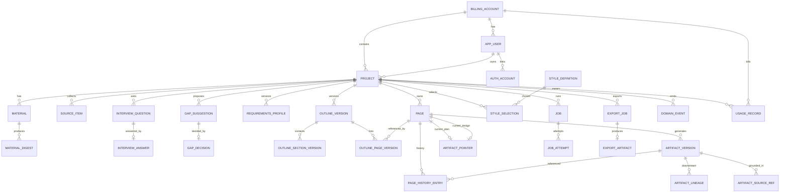

# Bound PPT · Data Model (v1.2)

> Version: v1.2 · 2026-11-19 · Status: Draft · Owner: Backend / Architecture
> Requirements source: `docs/ppt-agent-prd.md` (PRD v1).
> Logical source: `docs/ppt-agent-architecture.md` §7–§8 (conceptual entities, ownership, state, stale derivation).
> Implementation companion: `docs/ppt-agent-tech-stack.md` (runtime, framework, queue, object store, deployment).
> Scope: physical PostgreSQL model for M1 (paid-pilot readiness), with M2/M3 extension points. This document fills architecture decision **DD-19** (physical schema, indexes, partitioning) and the storage half of **DD-2/DD-4/DD-5**.

This document does not override the PRD or the architecture. Product behavior and acceptance stay with the PRD; component ownership and state semantics stay with the architecture. If this document disagrees with either, the PRD wins first, then the architecture, and the disagreement is logged in §15.

---

## 1. Document control

### 1.1 Metadata

| Field | Value |
| --- | --- |
| Document / version / date | Bound PPT Data Model / v1.1 / 2026-11-19 |
| Status / owner / audience | Draft / Backend + Architecture / backend, frontend, QA, security, finance |
| Requirements source | PRD v1: FR-1–FR-8, §8.9 matrices, §11 instrumentation, NFR-REL/COST/PRIV/SEC |
| Logical source | Architecture v1.1: §5 components, §7 conceptual data model, §8 state/consistency, §10 failure, §11 ledger, §12 privacy |
| Storage technology | PostgreSQL 16+ (default 17 at implementation start) + S3-compatible object storage. See `docs/ppt-agent-tech-stack.md` for products. |
| Schema tooling | SQLAlchemy 2.0 async + `asyncpg` + Alembic; hand-written Alembic migrations for partial indexes, checks, and deferrable foreign keys. |
| Supersedes / review cadence | v1 (Prisma/Node.js schema tooling; table/column/index semantics unchanged) / at M1, M2, M3 gates and before any schema-breaking migration |

### 1.2 Evidence tags

| Tag | Meaning |
| --- | --- |
| `[ARCH §x]` | Architecture v1 section. |
| `[PRD FR-x.y]`, `[PRD NFR-xxx-n]` | PRD requirement ID. |
| `[ASSUMPTION]` | Unverified premise that must be validated; not a commitment. |
| `[TBD-BIZ]` / `[TBD-UX]` / `[TBD-FE]` / `[TBD-BE]` / `[TBD-INFRA]` | Decision not yet made; owner and stage are stated. |
| `[TBD-TECH]` | Architecture-deferred technology choice; resolved here or in the tech-stack document. |
| `[CONFLICT]` | Sources disagree; resolution stated. |

Bare tags in compact tables inherit the owner/stage from the surrounding section or from §2.4/§15. A bare tag never means "no owner"; the owner and confirmation stage are stated in the nearest decision table.

### 1.3 Precedence and conflict rule

1. **Behavior and acceptance:** PRD wins.
2. **Component ownership, state ownership, consistency:** architecture wins.
3. **Storage shape, indexes, constraints, retention mechanics:** this document wins, within the two rules above.
4. A schema choice that changes a user-visible contract MUST be raised as a PRD/architecture change, not silently absorbed into a migration.

---

## 2. Scope and decisions

### 2.1 In scope

- Durable metadata for accounts/users (M1 pilot placeholder; M2 real accounts), projects, materials, research, profiles, outlines, style selections, page artifacts, history, jobs, exports, events, audit, policy records, and the usage/cost ledger.
- Physical keys, constraints, indexes, and the critical transaction protocols that keep the architecture's invariants true.
- Content/object-store key layout and retention mechanics.
- The SQLAlchemy 2.0 mapping conventions and core models (Appendix A) and SQL additions Alembic cannot express declaratively (Appendix B).
- M2/M3 extension points that must exist in M1 to avoid a schema rewrite (nullable tenancy, style scope, audit-shaped events, quota tables).

### 2.2 Out of scope

- Prompt text, model routing, token budgets, provider selection (tech-stack doc and runtime config).
- UI view state (selected page, open modal, countdown, local pin) — client-only `[PRD FR-6.3, FR-7.5]`.
- Deployment products, region, RPO/RTO numbers, backup vendor (tech-stack doc / `[TBD-INFRA]`).
- Billing provider, price points, invoice/tax model (M2; `[TBD-BIZ]`).
- Physical partitioning and multi-region topology — not needed at pilot scale; see §13.4.

### 2.3 Decisions made in this document

| ID | Decision | Rationale | Trace |
| --- | --- | --- | --- |
| DM-1 | PostgreSQL is the authoritative metadata, job, event, and ledger store. | Transactional invariants (state + event + job enqueue), partial indexes, `FOR UPDATE SKIP LOCKED`, JSONB, and one operational store at pilot scale. | `[ARCH §7.6, §8.6]` |
| DM-2 | Content lives in an object store; metadata rows hold immutable references and hashes only. | Satisfies the content/metadata split; keeps events/logs content-free. | `[ARCH §7.5; PRD NFR-PRIV-3]` |
| DM-3 | Artifacts are immutable versions with a separate current pointer. | Undo, previous version, export snapshots, and cost attribution must address a specific generation. | `[ARCH AD-3; PRD FR-6.5/6.21]` |
| DM-4 | Page identity is a first-class row (`page`), independent of outline version and position. | Reorder, cross-section move, insert, delete, history, and stale scope all need stable IDs. | `[ARCH AD-11]` |
| DM-5 | Staleness is derived from input fingerprints and lineage; stage/page status rows are rebuildable projections. | Survives restart, answers "which pages", keeps cascade factor near 1.0. | `[ARCH AD-4, §8.4]` |
| DM-6 | Every authoritative state change emits a per-project sequenced event in the same transaction. | Reconnect, audit, and projection rebuild need one ordered log. | `[ARCH §8.6, §9.2]` |
| DM-7 | Usage records are append-only and idempotent by `(operation_key, unit_type)`; corrections are adjustment rows. | Prevents duplicate charging on retry; supports invoice reconciliation. | `[ARCH AD-8, §11]` |
| DM-8 | Tenant scoping is nullable from M1 (`account_id` on account-scoped rows, FK to `billing_account`). | Avoids an M2 retrofit while allowing manual pilot onboarding. | `[ARCH AD-14; PRD-01]` |
| DM-9 | Input fingerprints use SHA-256 over RFC 8785 canonical JSON. | Deterministic across processes and languages; no timestamp or unordered JSON ambiguity. | `[ARCH §7.2]`; resolves digest algorithm `[TBD-TECH]` |
| DM-10 | IDs are UUIDv7 generated by the application, stored as PostgreSQL `uuid`. | Time-sortable for index locality; no database extension required. | Implementation choice |
| DM-11 | Timestamps are UTC `timestamptz(6)`; money is `numeric(18,6)`; counters are `bigint`. | Avoids timezone and floating-point ambiguity. | Implementation choice |
| DM-12 | M1 uses an in-process `asyncio` dispatch queue; the domain `job` row remains authoritative for status, attempts, cancellation, leases, fencing, and history. | No Redis or broker; transactional enqueue plus startup reconciliation gives restart recovery, and the transport is replaceable without a schema change. | `[ARCH AD-2]`; tech-stack §9 |
| DM-13 | Page history is a bounded stack; undo is a pointer move, never a regeneration. | Matches the architecture's undo semantics and zero-model-cost requirement. | `[ARCH §8.5; PRD FR-6.5]` |
| DM-14 | Chrome (page header, page number, section label, deck order) is not baked into the design artifact; it is a deterministic composition input. | Title/order changes must not cost a model job while still marking design stale. | `[ARCH AD-12; PRD §8.9.1 R1/R2]` |

### 2.4 Open decisions owned elsewhere

| Decision | Status | Owner / stage |
| --- | --- | --- |
| History depth vs artifact retention | `[TBD-BIZ · product + finance, before pilot]` — default config key, not a hard-coded number. | Product + finance |
| Event-log retention and full-resync threshold | `[TBD-INFRA · ops, before pilot]` | Architecture + ops |
| Export artifact retention / download URL lifetime | `[TBD-BIZ · legal + product, before paid pilot]` | Legal + product |
| Raw material retention after normalization | `[TBD-BIZ · legal, before paid pilot]` | Legal + founder |
| Outline page-matching rule on regeneration | `[TBD-BE · before outline v2]` (architecture AQ-2) | Backend + architecture |
| Malware scanning product | `[TBD-INFRA · security, before pilot]` | Security + tech lead |
| Data residency / region | `[TBD-BIZ · founder, before paid pilot]` (BM-8) | Founder + legal |

---

## 3. Modeling principles

These are implementation rules, not recommendations. A migration that violates one requires an explicit architecture change.

| # | Principle | Consequence |
| --- | --- | --- |
| P1 | **Server-authoritative state.** Stage, gates, page status, stale markers, history pointers, and job state are server rows. | The client stores only a projection and local drafts. `project_stage_state` is rebuildable, never client-written `[ARCH AD-1]`. |
| P2 | **Immutable artifacts.** A committed `artifact_version` is never updated; "current" is `artifact_pointer`. | Regeneration inserts a new version and moves the pointer; undo moves the pointer back `[ARCH AD-3]`. |
| P3 | **Stable page identity.** `page.id` is assigned once and never reused. Position and section are versioned outline fields. | Move/reorder/insert/delete do not break history or artifact ownership `[ARCH AD-11]`. |
| P4 | **Content/metadata split.** Material text, digests, prompts, model output, page bodies, and export packages live in object storage. | Event and log payloads carry IDs, counts, buckets, domains, timings, costs, and statuses only `[ARCH §7.5]`. |
| P5 | **Append-only truth for events and cost.** `domain_event` and `usage_record` are insert-only; corrections are new rows. | No `UPDATE`/`DELETE` on ledger rows; retention is an archival concern. |
| P6 | **Optimistic concurrency + idempotency.** Every mutating command carries an expected project version and an idempotency key. | A stale version returns `conflict`; a duplicate key returns the prior result or active job `[ARCH §8.6]`. |
| P7 | **Content before metadata, pointer after validation.** Object content is written first; the artifact row and pointer are committed in one DB transaction only after structured validation. | No pointer can reference missing or invalid content; an orphan sweeper removes unreferenced writes `[ARCH §7.2]`. |
| P8 | **One active operation per page/operation key.** | A unique active key prevents duplicate jobs and duplicate history entries `[ARCH §8.6]`. |
| P9 | **Derived status.** Page and stage status are computed from jobs, pointers, and fingerprints. | A projection audit recomputes and repairs drift; stale truth is never hand-maintained `[ARCH AD-4]`. |
| P10 | **Forward-only schema evolution.** `schema_version` is independent of optimistic `version`. | Migrations are expand/contract with lazy backfills; event consumers ignore unknown fields `[ARCH §8.9]`. |
| P11 | **Bounded history.** History has a configured maximum stack size. | Older versions remain immutable until retention/GC; undo cannot exceed the bound `[ARCH AQ-5]`. |
| P12 | **Tenant safety.** Every project query is scoped by project ID and, when present, account ID. | Cross-tenant access is a security defect; cache keys are tenant-scoped `[ARCH AD-13]`. |

---

## 4. Storage topology

| Store | Holds | Durability / access | Notes |
| --- | --- | --- | --- |
| PostgreSQL metadata DB | Accounts/users, projects, materials metadata, research state, outlines, style selections, artifact metadata, pointers, history, jobs, exports, events, audit, policy, ledger, config versions | Transactional, backed up, PITR | One primary at pilot scale; read replicas optional. |
| Object store (S3-compatible) | Raw uploads, normalized material text, digests, plan/design JSON, HTML/PDF/PPTX packages, model request/response audit payloads | Immutable objects, encryption at rest, no public access, lifecycle rules | Access only through short-lived authorized references. |
| Job queue | Dispatch of async work | In-process `asyncio` queue fed by committed `job` rows | The `job` row is authoritative; the in-memory queue holds only `job_id`s. A startup + periodic reconciler re-wakes `QUEUED` rows and requeues expired leases, so a process restart loses dispatch state but never committed work. No `job_outbox`, Redis, or broker. See tech-stack §9. |
| Event log | Ordered per-project domain events | `domain_event` table, append-only | Used by SSE, reconnect, projection rebuild, audit. |
| Usage/cost ledger | Billable units and estimated/actual cost | `usage_record` table, append-only | Source for `cost_per_*` metrics and quota. |
| Cache | Rebuildable projections, render cache, project snapshot cache, config cache | PostgreSQL tables + process memory | Never a source of truth; TTL/version-keyed and tenant-scoped. |

No Redis is required for M1. If SSE fan-out, rate limiting, or cache throughput later exceeds a single process/PostgreSQL deployment, Redis or a shared queue is added behind the same interfaces; it must not become authoritative `[TBD-INFRA · ops, M2 planning]`.

---

## 5. Logical model and ownership

### 5.1 Entity relationship overview



### 5.2 Ownership map

| Data | Authoritative table(s) | Refs |
| --- | --- | --- |
| Account/user identity, billing status | `billing_account`, `app_user`, `session`, `auth_account` | `[ARCH §7.3]` |
| Project lifecycle, stage, mode, version, epoch, current pointers | `project` | `[PRD FR-7.8/7.9, FR-8.1]` |
| Stage/page/stale projections | `project_stage_state`, derived page-status queries | Rebuildable; never authoritative `[ARCH §7.3]` |
| Material registry and ingestion status | `material` | `[PRD FR-1.3–1.11]` |
| Per-material extraction | `material_digest` | `[PRD FR-2.5]` |
| Source panel items | `source_item` | `[PRD FR-2.15]` |
| Interview questions/answers | `interview_question`, `interview_answer` | `[PRD FR-2.3/2.4]` |
| Gap suggestions/decisions | `gap_suggestion`, `gap_decision` | `[PRD FR-2.6/2.7]` |
| Profile versions | `requirements_profile` | `[PRD FR-2.12/2.13]` |
| Page identity registry | `page` | `[ARCH AD-11]` |
| Outline versions | `outline_version`, `outline_section_version`, `outline_page_version` | `[PRD FR-3.1–3.10]` |
| Style definitions/selections | `style_definition`, `style_selection` | `[PRD FR-5.1–5.6]` |
| Plan/design versions, pointers, history, lineage | `artifact_version`, `artifact_pointer`, `page_history_entry`, `artifact_lineage`, `artifact_source_ref` | `[PRD FR-6.2–6.9, FR-7.7]` |
| Job state/attempts | `job`, `job_attempt` | `[PRD FR-7.5; ARCH §8.2]` |
| Export state/report/package | `export_job`, `export_artifact` | `[PRD FR-6.10–6.21]` |
| Cost/quota | `usage_record`, `quota_counter` | `[PRD §11; ARCH §11]` |
| Event/audit/policy | `domain_event`, `audit_event`, `policy_record` | `[PRD §11.5; ARCH §12]` |
| Config/model profile versions | `generation_profile`, `config_version` | `[ARCH §8.9]` |

---

## 6. Table catalog

Physical column names below are authoritative. SQLAlchemy models (Appendix A) MUST map to these exact table and column names; migrations are the executable form of this catalog. Types are PostgreSQL types.

### 6.1 Identity and tenancy

#### `billing_account`

The architecture's **Account (M2)** maps to this business billing/tenant row. Identity-link rows are a separate `auth_account` table and are not the billing boundary. M1 may use a single pilot account per design partner; M2 makes this the billing boundary. `[ARCH AD-14; PRD-01]`

| Column | Type | Constraints | Notes |
| --- | --- | --- | --- |
| `id` | `uuid` | PK | UUIDv7. |
| `name` | `text` | nullable | Account display name. |
| `plan` | `text` | NOT NULL, default `'pilot'` | M1 pilot; M2 plan key. |
| `billing_status` | `text` | nullable | M2. |
| `created_at` | `timestamptz(6)` | NOT NULL, default now | |
| `updated_at` | `timestamptz(6)` | NOT NULL | |
| `deleted_at` | `timestamptz(6)` | nullable | Soft delete; financial rows follow legal retention. |

Indexes: primary key only at pilot scale; add `(deleted_at)` partial when account lists exist.

#### `app_user`

| Column | Type | Constraints | Notes |
| --- | --- | --- | --- |
| `id` | `uuid` | PK | |
| `account_id` | `uuid` | FK → `billing_account.id`, nullable | Nullable for pre-account pilot provisioning. |
| `email` | `text` | UNIQUE, NOT NULL | Auth identity; encrypted at rest by the database volume. |
| `email_verified` | `timestamptz(6)` | nullable | Reserved for M2 email verification. |
| `image` | `text` | nullable | Avatar URL; no content. |
| `name` | `text` | nullable | |
| `role` | `user_role` | NOT NULL, default `'OWNER'` | M3 expands roles. |
| `created_at` / `updated_at` / `deleted_at` | `timestamptz(6)` | | |

Indexes: `(account_id)`.

#### `session`, `auth_account`, `verification_token`

Session and M2 identity-link tables. The web client authenticates with an opaque session token in an HttpOnly cookie; only the token hash is stored in `session`, and revocation is a row delete. `auth_account` is reserved for M2 OIDC/provider links; it is not the business billing entity (that is `billing_account`). These tables hold no project content. Do not cache sessions as authoritative state. Provider tokens in `auth_account` are sensitive: encrypted at rest and never logged.

| Table | Key columns | Constraint |
| --- | --- | --- |
| `session` | `id`, `session_token`, `user_id`, `expires` | `session_token` unique; FK user cascade. |
| `auth_account` | `id`, `user_id`, `provider`, `provider_account_id` | `(provider, provider_account_id)` unique. |
| `verification_token` | `identifier`, `token`, `expires` | `token` unique; `(identifier, token)` unique. |

### 6.2 Project and workflow

#### `project`

| Column | Type | Constraints | Notes |
| --- | --- | --- | --- |
| `id` | `uuid` | PK | |
| `account_id` | `uuid` | FK → `billing_account.id`, nullable | Tenant scope. |
| `owner_user_id` | `uuid` | FK → `app_user.id`, nullable | M1 pilot owner. |
| `name` | `text` | NOT NULL | Defaults to topic at creation `[PRD FR-8.1]`. |
| `topic` | `text` | NOT NULL | Sensitive; never emitted to logs/events. |
| `mode` | `project_mode` | NOT NULL, default `'FULLY_AUTOMATIC'` | `FULLY_AUTOMATIC` \| `EXPERT_COPILOT`. |
| `status` | `project_status` | NOT NULL, default `'ACTIVE'` | `ACTIVE` \| `DELETING` \| `DELETED`. |
| `stage` | `stage` | NOT NULL, default `'INTAKE'` | Current stage. |
| `version` | `int` | NOT NULL, default 1 | Optimistic concurrency token; incremented by every mutating command. |
| `epoch` | `int` | NOT NULL, default 1 | Restart counter; older-epoch job results are discarded `[PRD FR-7.8]`. |
| `schema_version` | `int` | NOT NULL, default 1 | Lazy migration version. |
| `current_profile_version_id` | `uuid` | FK → `requirements_profile.id` (deferrable) | Pointer, not a projection. |
| `current_outline_version_id` | `uuid` | FK → `outline_version.id` (deferrable) | Pointer. |
| `current_style_selection_id` | `uuid` | FK → `style_selection.id` (deferrable) | Pointer. |
| `created_at` / `updated_at` | `timestamptz(6)` | NOT NULL | |
| `deleted_at` | `timestamptz(6)` | nullable | Soft delete / tombstone. |
| `purge_after` | `timestamptz(6)` | nullable | Deletion sweeper target. |

Indexes: `(account_id, updated_at)`, `(owner_user_id, updated_at)`, `(status, purge_after)`.
Checks: `version >= 1`, `epoch >= 1`, `schema_version >= 1`.

#### `project_stage_state`

| Column | Type | Constraints | Notes |
| --- | --- | --- | --- |
| `project_id` | `uuid` | FK → project, cascade | |
| `stage` | `stage` | NOT NULL | |
| `status` | `stage_status` | NOT NULL, default `'LOCKED'` | `LOCKED` \| `AVAILABLE` \| `IN_PROGRESS` \| `COMPLETE` \| `STALE` \| `ERROR`. |
| `reachable` | `boolean` | NOT NULL, default false | Derived from gates. |
| `stale_reasons` | `jsonb` | nullable | Content-free reasons, e.g. `{"plan":["profile_version_changed"]}`. |
| `updated_at` | `timestamptz(6)` | NOT NULL | |

Primary key `(project_id, stage)`. Index `(project_id, status)`. This table is a projection and MUST be rebuildable from `project`, artifacts, and jobs.

#### `project_event_counter`

| Column | Type | Constraints | Notes |
| --- | --- | --- | --- |
| `project_id` | `uuid` | PK, FK → project, cascade | |
| `last_sequence` | `bigint` | NOT NULL, default 0 | Incremented with `UPDATE … RETURNING` inside the event transaction. |

### 6.3 Ingestion and research

#### `material`

| Column | Type | Constraints | Notes |
| --- | --- | --- | --- |
| `id` | `uuid` | PK | |
| `project_id` | `uuid` | FK → project, cascade | |
| `kind` | `material_kind` | NOT NULL | `PASTE` \| `FILE` \| `URL`. |
| `status` | `material_status` | NOT NULL, default `'PENDING'` | `PENDING` \| `INGESTING` \| `DIGESTED` \| `FAILED` \| `REMOVED`. |
| `display_name` | `text` | NOT NULL | User-facing chip label; content-bearing, excluded from telemetry. |
| `mime_type` | `text` | nullable | Sniffed/validated type. |
| `size_bytes` | `bigint` | NOT NULL, default 0 | Check `>= 0`. |
| `page_count` | `int` | nullable | For parse limits and buckets. |
| `content_ref` | `text` | nullable | Normalized text object key. |
| `raw_ref` | `text` | nullable | Raw upload object key. |
| `source_url` | `text` | nullable | Full URL; restricted, never in logs/events. |
| `domain` | `text` | nullable | Allowed in telemetry. |
| `error_code` / `error_message_key` | `text` | nullable | Stable codes, not user text. |
| `version` | `int` | NOT NULL, default 1 | Material record version. |
| `created_at` / `updated_at` | `timestamptz(6)` | NOT NULL | |
| `removed_at` | `timestamptz(6)` | nullable | Removed chip; ingestion cancellation. |

Indexes: `(project_id, status)`, `(project_id, created_at)`.

#### `material_digest`

| Column | Type | Constraints | Notes |
| --- | --- | --- | --- |
| `id` | `uuid` | PK | |
| `project_id` | `uuid` | FK → project, cascade | Denormalized for tenant-scoped reads; MUST match `material.project_id`. |
| `material_id` | `uuid` | FK → material, cascade | |
| `version` | `int` | NOT NULL, default 1 | Re-digest creates a new version. |
| `is_current` | `boolean` | NOT NULL, default true | Partial unique index in Appendix B. |
| `status` | `digest_status` | NOT NULL, default `'PENDING'` | `PENDING` \| `READY` \| `FAILED`. |
| `digest_ref` | `text` | nullable | Object key for the extraction summary. |
| `extracted_char_count` | `int` | nullable | Bucketable metadata. |
| `length_bucket` | `text` | nullable | E.g. `short` / `medium` / `long`; no content. |
| `parser_profile_version` | `text` | NOT NULL | Part of the material→digest fingerprint. |
| `producer_job_id` | `uuid` | nullable | |
| `created_at` | `timestamptz(6)` | NOT NULL | |

Unique `(material_id, version)`; partial unique current digest per material.
When a new digest version is committed, the application MUST set the previous `is_current` row to `false` in the same transaction before inserting/flipping the new current row; the partial unique index is the guard.

#### `source_item`

| Column | Type | Constraints | Notes |
| --- | --- | --- | --- |
| `id` | `uuid` | PK | |
| `project_id` | `uuid` | FK → project, cascade | |
| `origin` | `source_origin` | NOT NULL | `PROVIDED` \| `WEB`. |
| `source_type` | `source_type` | NOT NULL | `PASTE` \| `FILE` \| `URL` \| `WEB_RESULT` \| `INTERVIEW_ANSWER`. |
| `title` | `text` | NOT NULL | Content-bearing; shown in the source panel. |
| `summary` | `text` | NOT NULL | Content-bearing; shown in the source panel. |
| `domain` | `text` | nullable | Telemetry-safe. |
| `url_hash` | `text` | nullable | SHA-256 of the full URL; no full URL in telemetry. |
| `content_ref` | `text` | nullable | Normalized source text, if stored. |
| `material_id` | `uuid` | FK → material, `SET NULL` | Present for material-derived sources. |
| `gap_suggestion_id` | `uuid` | FK → gap_suggestion, `SET NULL` | Present for web results tied to a gap. |
| `rank` | `int` | NOT NULL, default 0 | Display order / relevance. |
| `created_at` | `timestamptz(6)` | NOT NULL | |

Indexes: `(project_id, origin, created_at)`, `(project_id, rank)`.

#### `interview_question`

| Column | Type | Constraints | Notes |
| --- | --- | --- | --- |
| `id` | `uuid` | PK | |
| `project_id` | `uuid` | FK → project, cascade | |
| `question_key` | `text` | NOT NULL | Stable identity, e.g. `audience`. |
| `position` | `int` | NOT NULL | One-at-a-time order. |
| `prompt` | `text` | NOT NULL | Question text. |
| `options` | `jsonb` | NOT NULL | Option set snapshot. |
| `catalog_version` | `text` | NOT NULL | Question-catalog version. |
| `created_at` | `timestamptz(6)` | NOT NULL | |

Unique `(project_id, question_key)`, `(project_id, position)`.

#### `interview_answer`

| Column | Type | Constraints | Notes |
| --- | --- | --- | --- |
| `id` | `uuid` | PK | |
| `project_id` | `uuid` | FK → project, cascade | |
| `question_id` | `uuid` | UNIQUE, FK → interview_question, cascade | One answer per identity; edits overwrite `[PRD FR-2.4]`. |
| `option_key` | `text` | NOT NULL | |
| `revision` | `int` | NOT NULL, default 1 | Increments on edit; does not create extra answers. |
| `created_at` / `updated_at` | `timestamptz(6)` | NOT NULL | |

Index `(project_id, updated_at)`.

#### `gap_suggestion`

| Column | Type | Constraints | Notes |
| --- | --- | --- | --- |
| `id` | `uuid` | PK | |
| `project_id` | `uuid` | FK → project, cascade | |
| `batch` | `int` | NOT NULL, default 1 | Re-research creates a new batch; old suggestions remain immutable. |
| `label` | `text` | NOT NULL | Content-bearing. |
| `reason` | `text` | NOT NULL | Content-bearing. |
| `recommended` | `boolean` | NOT NULL, default false | Pre-checked suggestion. |
| `position` | `int` | NOT NULL | 1–3 in M1. |
| `status` | `gap_status` | NOT NULL, default `'SUGGESTED'` | `SUGGESTED` \| `SELECTED` \| `REJECTED`. |
| `producer_job_id` | `uuid` | nullable | |
| `created_at` | `timestamptz(6)` | NOT NULL | |

Index `(project_id, batch, position)`.

#### `gap_decision`

| Column | Type | Constraints | Notes |
| --- | --- | --- | --- |
| `id` | `uuid` | PK | |
| `project_id` | `uuid` | FK → project, cascade | |
| `gap_suggestion_id` | `uuid` | UNIQUE, FK → gap_suggestion, cascade | One decision per suggestion. |
| `selected` | `boolean` | NOT NULL | `false` plus profile `web_skipped = true` represents "not needed". |
| `decided_at` | `timestamptz(6)` | NOT NULL | Immutable after profile creation `[PRD FR-2.21]`. |

Index `(project_id, decided_at)`.

#### `requirements_profile`

| Column | Type | Constraints | Notes |
| --- | --- | --- | --- |
| `id` | `uuid` | PK | |
| `project_id` | `uuid` | FK → project, cascade | |
| `version` | `int` | NOT NULL | Immutable profile version. |
| `audience` / `goal` / `style_mood` | `text` | NOT NULL | Profile fields. |
| `page_count` | `int` | NOT NULL | Check `> 0`. |
| `materials_summary` | `jsonb` | NOT NULL | Material IDs/counts and strategy, not full text. |
| `web_scope` | `jsonb` | NOT NULL | Gap decisions, selected gap labels/IDs, skipped flag. |
| `web_skipped` | `boolean` | NOT NULL, default false | "Not needed — just use my materials". |
| `content_strategy` | `text` | NOT NULL | Includes first-party priority statement. |
| `source_refs` | `jsonb` | NOT NULL | Source item IDs used. |
| `input_fingerprint` | `text` | NOT NULL | SHA-256 canonical input. |
| `producer_job_id` | `uuid` | nullable | |
| `created_at` | `timestamptz(6)` | NOT NULL | |

Unique `(project_id, version)`; index `(project_id, created_at)`.

### 6.4 Page identity, outline, and style

#### `page`

| Column | Type | Constraints | Notes |
| --- | --- | --- | --- |
| `id` | `uuid` | PK | Stable page identity; never reused `[ARCH AD-11]`. |
| `project_id` | `uuid` | FK → project, cascade | |
| `page_type` | `page_type` | NOT NULL | `COVER` \| `TOC` \| `BODY` \| `END`. |
| `created_at` | `timestamptz(6)` | NOT NULL | |
| `retired_at` | `timestamptz(6)` | nullable | Deleted body page; artifacts/history tombstoned. |

Index `(project_id, retired_at)`. Cover/TOC/end are created at outline v1 and cannot be retired.

#### `outline_version`

| Column | Type | Constraints | Notes |
| --- | --- | --- | --- |
| `id` | `uuid` | PK | |
| `project_id` | `uuid` | FK → project, cascade | |
| `version` | `int` | NOT NULL | Immutable version. |
| `confirmed_at` | `timestamptz(6)` | nullable | User confirmation. |
| `confirmed_by_user_id` | `uuid` | nullable | |
| `input_fingerprint` | `text` | NOT NULL | Profile + sources + interview + schema version. |
| `producer_job_id` | `uuid` | nullable | |
| `schema_version` | `int` | NOT NULL, default 1 | Outline JSON schema version. |
| `created_at` | `timestamptz(6)` | NOT NULL | |

Unique `(project_id, version)`; index `(project_id, created_at)`.
The outline **content** (version, sections, pages, `input_fingerprint`) is immutable. `confirmed_at` / `confirmed_by_user_id` are mutable confirmation metadata: a profile update clears `confirmed_at` on the current outline version without rewriting its content, matching the "outline needs reconfirmation" gate `[PRD FR-2.14, FR-3.14]`.

#### `outline_section_version`

| Column | Type | Constraints | Notes |
| --- | --- | --- | --- |
| `id` | `uuid` | PK | |
| `outline_version_id` | `uuid` | FK → outline_version, cascade | |
| `section_key` | `text` | NOT NULL | Stable within a version, e.g. `part-1`. |
| `title` | `text` | NOT NULL | Section title. |
| `position` | `int` | NOT NULL | |

Unique `(outline_version_id, section_key)`, `(outline_version_id, position)`.

#### `outline_page_version`

| Column | Type | Constraints | Notes |
| --- | --- | --- | --- |
| `id` | `uuid` | PK | |
| `outline_version_id` | `uuid` | FK → outline_version, cascade | |
| `page_id` | `uuid` | FK → page | Stable identity. |
| `position` | `int` | NOT NULL | Deck order. |
| `section_key` | `text` | NOT NULL | Body page section; cover/TOC/end may use reserved keys. |
| `title` | `text` | NOT NULL | |
| `page_type` | `page_type` | NOT NULL | |
| `key_points` | `jsonb` | NOT NULL | Content keywords; content-bearing. |
| `created_at` | `timestamptz(6)` | NOT NULL | |

Unique `(outline_version_id, page_id)`, `(outline_version_id, position)`; index `(page_id)`.

#### `style_definition`

| Column | Type | Constraints | Notes |
| --- | --- | --- | --- |
| `id` | `uuid` | PK | |
| `key` | `text` | NOT NULL | E.g. `editorial-indigo`. |
| `name` | `text` | NOT NULL | |
| `version` | `int` | NOT NULL | Token version. |
| `scope` | `style_scope` | NOT NULL, default `'BUILTIN'` | `BUILTIN` \| `ACCOUNT` \| `ORGANIZATION`. |
| `palette` | `jsonb` | NOT NULL | Display palette. |
| `tokens` | `jsonb` | NOT NULL | Typography, spacing, radii, shadows. |
| `preview_ref` | `text` | nullable | Object key. |
| `description` | `text` | NOT NULL | |
| `license_status` | `license_status` | NOT NULL, default `'UNKNOWN'` | Export gate. |
| `is_active` | `boolean` | NOT NULL, default true | |
| `created_at` | `timestamptz(6)` | NOT NULL | |

Unique `(key, version)`; index `(scope, is_active)`.

#### `style_selection`

| Column | Type | Constraints | Notes |
| --- | --- | --- | --- |
| `id` | `uuid` | PK | |
| `project_id` | `uuid` | FK → project, cascade | |
| `style_definition_id` | `uuid` | FK → style_definition | |
| `style_version` | `int` | NOT NULL | Snapshot of the chosen version. |
| `confirmed_at` | `timestamptz(6)` | nullable | |
| `remember_preference` | `boolean` | NOT NULL, default false | M1 project scope; M2 account scope. |
| `version` | `int` | NOT NULL, default 1 | |
| `created_at` | `timestamptz(6)` | NOT NULL | |

Index `(project_id, created_at)`.

#### `account_style_preference` (M2)

| Column | Type | Constraint |
| --- | --- | --- |
| `account_id` | `uuid` | PK, FK → billing_account |
| `style_key` | `text` | NOT NULL |
| `style_version` | `int` | NOT NULL |
| `updated_at` | `timestamptz(6)` | NOT NULL |

### 6.5 Artifacts, pointers, history, lineage

#### `artifact_version`

| Column | Type | Constraints | Notes |
| --- | --- | --- | --- |
| `id` | `uuid` | PK | |
| `project_id` | `uuid` | FK → project, cascade | |
| `page_id` | `uuid` | FK → page | |
| `kind` | `artifact_kind` | NOT NULL | `PLAN` \| `DESIGN`. |
| `version` | `int` | NOT NULL | Per page/kind, starts at 1. |
| `content_ref` | `text` | NOT NULL | Object key for the structured body JSON. |
| `content_digest` | `text` | NOT NULL | SHA-256 of the stored content. |
| `mime_type` | `text` | NOT NULL | `application/json` for plan/design body. |
| `byte_size` | `bigint` | NOT NULL | Check `>= 0`. |
| `input_fingerprint` | `text` | NOT NULL | SHA-256 canonical input. |
| `upstream_refs` | `jsonb` | NOT NULL | Denormalized upstream IDs for fast explanation. |
| `source_refs` | `jsonb` | NOT NULL | Source item IDs used for grounding. |
| `producer_job_id` | `uuid` | nullable | |
| `producer_attempt_id` | `uuid` | nullable | |
| `producer_model` | `text` | nullable | Provider/model key. |
| `prompt_version` | `text` | nullable | |
| `schema_version` | `int` | NOT NULL, default 1 | Artifact content schema. |
| `created_at` | `timestamptz(6)` | NOT NULL | |

Unique `(project_id, page_id, kind, version)`; indexes `(project_id, page_id, kind, created_at)`, `(project_id, input_fingerprint)`.
Checks: `version >= 1`, `byte_size >= 0`.

#### `artifact_pointer`

| Column | Type | Constraints | Notes |
| --- | --- | --- | --- |
| `id` | `uuid` | PK | |
| `project_id` | `uuid` | FK → project, cascade | |
| `page_id` | `uuid` | FK → page | |
| `kind` | `artifact_kind` | NOT NULL | |
| `artifact_version_id` | `uuid` | FK → artifact_version | |
| `updated_at` | `timestamptz(6)` | NOT NULL | |

Unique `(project_id, page_id, kind)`. Installing a pointer is the commit point for "current".

#### `page_history_entry`

| Column | Type | Constraints | Notes |
| --- | --- | --- | --- |
| `id` | `uuid` | PK | |
| `project_id` | `uuid` | FK → project, cascade | |
| `page_id` | `uuid` | FK → page | |
| `kind` | `artifact_kind` | NOT NULL | |
| `artifact_version_id` | `uuid` | FK → artifact_version | Prior version. |
| `stack_sequence` | `bigint` | NOT NULL | Monotonic per page/kind; the highest active row is the top of the undo stack. No shifting on push. |
| `reason` | `history_reason` | NOT NULL | Why it was pushed. |
| `created_at` | `timestamptz(6)` | NOT NULL | |
| `popped_at` | `timestamptz(6)` | nullable | Undo marks the top as popped; row is retained for audit. |

Index `(project_id, page_id, kind, stack_sequence)`; partial unique active stack sequence in Appendix B.
Check `stack_sequence >= 1`.

#### `artifact_lineage`

| Column | Type | Constraints | Notes |
| --- | --- | --- | --- |
| `id` | `uuid` | PK | |
| `project_id` | `uuid` | FK → project, cascade | |
| `downstream_artifact_version_id` | `uuid` | FK → artifact_version, cascade | |
| `upstream_type` | `text` | NOT NULL | `outline_page_version` \| `outline_version` \| `artifact_version` \| `style_definition` \| `requirements_profile` \| `material_digest` \| `source_item`. |
| `upstream_id` | `uuid` | NOT NULL | ID of the upstream row. |
| `relation` | `text` | NOT NULL | E.g. `plan_from_outline`, `design_from_plan`, `design_from_style`. |
| `created_at` | `timestamptz(6)` | NOT NULL | |

Unique `(downstream_artifact_version_id, upstream_type, upstream_id)`; index `(project_id, upstream_type, upstream_id)`.

#### `artifact_source_ref`

| Column | Type | Constraints | Notes |
| --- | --- | --- | --- |
| `id` | `uuid` | PK | |
| `project_id` | `uuid` | FK → project, cascade | |
| `artifact_version_id` | `uuid` | FK → artifact_version, cascade | |
| `source_item_id` | `uuid` | FK → source_item, cascade | |
| `role` | `text` | NOT NULL, default `'grounding'` | E.g. `primary_fact`, `supporting`, `interview`. |
| `created_at` | `timestamptz(6)` | NOT NULL | |

Unique `(artifact_version_id, source_item_id, role)`; index `(source_item_id)`.

#### `render_cache`

| Column | Type | Constraints | Notes |
| --- | --- | --- | --- |
| `id` | `uuid` | PK | |
| `project_id` | `uuid` | FK → project, cascade | |
| `page_id` | `uuid` | FK → page | |
| `artifact_version_id` | `uuid` | FK → artifact_version | Design body version. |
| `chrome_version` | `text` | NOT NULL | Deterministic hash of outline chrome + deck order. |
| `output_ref` | `text` | NOT NULL | Rendered preview object key (PNG/HTML). |
| `content_digest` | `text` | NOT NULL | |
| `created_at` | `timestamptz(6)` | NOT NULL | |

Unique `(project_id, page_id, artifact_version_id, chrome_version)`. Rebuildable; never authoritative.

### 6.6 Jobs

#### `job`

| Column | Type | Constraints | Notes |
| --- | --- | --- | --- |
| `id` | `uuid` | PK | |
| `project_id` | `uuid` | FK → project, cascade | |
| `type` | `job_type` | NOT NULL | `INGEST` \| `DIGEST` \| `SEARCH` \| `GAP_SUGGEST` \| `PROFILE` \| `OUTLINE` \| `PLAN_PAGE` \| `DESIGN_PAGE` \| `EXPORT` \| `DELETE_PROJECT`. `SEARCH` is the targeted-gap-search job required by the API contract; it is an additive enum value (migration) and runs one query per selected gap. |
| `operation_key` | `text` | NOT NULL | Intent key, e.g. `design_page:{page_id}:regen:{n}`. |
| `active_operation_key` | `text` | UNIQUE, nullable | Set while queued/running; nulled on terminal state. Enforces one active operation. |
| `state` | `job_state` | NOT NULL, default `'QUEUED'` | `QUEUED` \| `RUNNING` \| `SUCCEEDED` \| `FAILED` \| `CANCELLED` \| `EXPIRED`. |
| `priority` | `int` | NOT NULL, default 0 | Higher first. |
| `payload` | `jsonb` | NOT NULL | IDs and non-content parameters only. |
| `instruction_ref` | `text` | nullable | Object key for a user tweak instruction (content). |
| `deadline_at` | `timestamptz(6)` | nullable | |
| `cancel_requested_at` | `timestamptz(6)` | nullable | Cooperative cancellation. |
| `attempt_count` | `int` | NOT NULL, default 0 | |
| `max_attempts` | `int` | NOT NULL, default 3 | |
| `lease_owner` | `text` | nullable | Worker ID. |
| `lease_expires_at` | `timestamptz(6)` | nullable | |
| `fencing_token` | `bigint` | NOT NULL, default 0 | Incremented on each lease; commit must match. |
| `last_error_code` / `last_error_class` | `text` | nullable | Stable codes. |
| `queue_job_id` | `text` | nullable | Unused in M1; reserved for a future external transport. The in-process queue holds `job.id` only. |
| `created_at` / `updated_at` | `timestamptz(6)` | NOT NULL | |
| `completed_at` | `timestamptz(6)` | nullable | |

Indexes: `(project_id, state, created_at)`, `(state, priority, created_at)`; partial reconciler index in Appendix B.
Checks: `attempt_count >= 0`, `max_attempts > 0`, `fencing_token >= 0`.

#### `job_attempt`

| Column | Type | Constraints | Notes |
| --- | --- | --- | --- |
| `id` | `uuid` | PK | |
| `job_id` | `uuid` | FK → job, cascade | |
| `attempt_no` | `int` | NOT NULL | 1-based. |
| `state` | `job_attempt_state` | NOT NULL, default `'RUNNING'` | |
| `worker_id` | `text` | nullable | |
| `fencing_token` | `bigint` | NOT NULL | Lease token used for commit. |
| `started_at` | `timestamptz(6)` | NOT NULL | |
| `ended_at` | `timestamptz(6)` | nullable | |
| `error_code` / `error_class` | `text` | nullable | |
| `provider` / `model_id` | `text` | nullable | Model call attribution. |
| `input_tokens` / `output_tokens` | `int` | nullable | Provider-reported or measured. |
| `latency_ms` | `int` | nullable | |
| `estimated_cost` | `numeric(18,6)` | nullable | Check `>= 0`. |
| `created_at` | `timestamptz(6)` | NOT NULL | |

Unique `(job_id, attempt_no)`; index `(job_id, started_at)`.

### 6.7 Export

#### `export_job`

| Column | Type | Constraints | Notes |
| --- | --- | --- | --- |
| `id` | `uuid` | PK | |
| `project_id` | `uuid` | FK → project, cascade | |
| `format` | `export_format` | NOT NULL | `PPTX` \| `HTML` \| `PDF`. |
| `state` | `export_state` | NOT NULL, default `'QUEUED'` | `QUEUED` \| `VALIDATING` \| `COMPOSING` \| `PACKAGING` \| `SUCCEEDED` \| `FAILED` \| `CANCELLED`. |
| `deck_snapshot` | `jsonb` | NOT NULL | Ordered page IDs, current design artifact version IDs, style definition/version, format, render completeness. IDs only. |
| `validation_report` | `jsonb` | nullable | Checks, failed checks, affected page IDs, reasons. |
| `error_code` | `text` | nullable | |
| `created_at` / `started_at` / `completed_at` | `timestamptz(6)` | | |

Indexes: `(project_id, created_at)`, `(state, created_at)`.

#### `export_artifact`

| Column | Type | Constraints | Notes |
| --- | --- | --- | --- |
| `id` | `uuid` | PK | |
| `export_job_id` | `uuid` | UNIQUE, FK → export_job, cascade | One package per job. |
| `project_id` | `uuid` | NOT NULL | Tenant-scoped lookup. |
| `object_key` | `text` | NOT NULL | |
| `checksum` | `text` | NOT NULL | SHA-256. |
| `byte_size` | `bigint` | NOT NULL | Check `> 0`; zero-byte artifact is failure `[PRD FR-6.16]`. |
| `mime_type` | `text` | NOT NULL | |
| `substitution_report` | `jsonb` | nullable | Font/asset substitutions. |
| `created_at` | `timestamptz(6)` | NOT NULL | |
| `expires_at` | `timestamptz(6)` | nullable | Retention config `[TBD-BIZ]`. |

Indexes: `(project_id, created_at)`, `(expires_at)`.

### 6.8 Events, audit, policy, idempotency

#### `domain_event`

| Column | Type | Constraints | Notes |
| --- | --- | --- | --- |
| `id` | `uuid` | PK | |
| `project_id` | `uuid` | FK → project, cascade | |
| `sequence` | `bigint` | NOT NULL | Per-project monotonic. |
| `type` | `text` | NOT NULL | Event name from PRD §11.2. |
| `schema_version` | `int` | NOT NULL, default 1 | |
| `payload` | `jsonb` | NOT NULL | Content-free. |
| `request_id` | `text` | nullable | |
| `trace_id` | `text` | nullable | |
| `created_at` | `timestamptz(6)` | NOT NULL | |

Unique `(project_id, sequence)`; indexes `(project_id, created_at)`, `(type, created_at)`.
The event log is the durable stream; `outline_delta` is ephemeral and is not stored here `[ARCH §9.2]`.

#### `usage_record`

Append-only cost/quota ledger `[ARCH §11; PRD §11.4]`. Corrections are new adjustment rows, never updates.

| Column | Type | Constraints | Notes |
| --- | --- | --- | --- |
| `id` | `uuid` | PK | |
| `unique_key` | `text` | UNIQUE, nullable | Derived as `operation_key + ':' + unit_type` for original rows; null on adjustment rows. The unique constraint is the primary guard; Appendix B also enforces the architecture's `(operation_key, unit_type)` invariant with a partial index. |
| `operation_key` | `text` | NOT NULL | Logical billable operation; retries reuse it. |
| `adjustment_of` | `uuid` | nullable | Points to the original `usage_record.id` for a correction. |
| `project_id` | `uuid` | FK → project, `SET NULL`, nullable | |
| `account_id` | `uuid` | FK → billing_account, `SET NULL`, nullable | M2 billing. |
| `stage` | `stage` | nullable | Attribution. |
| `page_id` | `uuid` | nullable | Attribution for page-level jobs. |
| `job_id` | `uuid` | nullable | Attribution. |
| `attempt_id` | `uuid` | nullable | Failed attempts are metered but not charged twice. |
| `provider` | `text` | nullable | Model/search/parse provider key. |
| `capability` | `text` | NOT NULL | E.g. `model.design`, `search.query`, `parse.pdf`, `export.pptx`. |
| `unit_type` | `text` | NOT NULL | E.g. `input_token`, `output_token`, `query`, `page`, `byte`. |
| `quantity` | `numeric(18,6)` | NOT NULL | Check `>= 0`. |
| `unit_price_version` | `text` | nullable | Price table version. |
| `estimated_cost` | `numeric(18,6)` | nullable | Check `>= 0`. |
| `actual_cost` | `numeric(18,6)` | nullable | Check `>= 0`; reconciliation. |
| `currency` | `text` | NOT NULL, default `'USD'` | |
| `occurred_at` | `timestamptz(6)` | NOT NULL | |

Indexes: `(project_id, occurred_at)`, `(account_id, occurred_at)`, `(job_id)`, `(operation_key)`.
Rules: no `UPDATE`/`DELETE`; `(operation_key, unit_type)` is unique for original rows; an adjustment row references the original and carries the corrected amount `[PRD NFR-COST-2]`. Original rows MUST set `unique_key`; adjustment rows leave it null.

#### `audit_event`

| Column | Type | Constraints | Notes |
| --- | --- | --- | --- |
| `id` | `uuid` | PK | |
| `actor_user_id` | `uuid` | FK → app_user, `SET NULL` | |
| `project_id` | `uuid` | FK → project, `SET NULL` | |
| `action` | `text` | NOT NULL | E.g. `project.view`, `artifact.download`, `support.break_glass`. |
| `target_type` / `target_id` | `text` / `uuid` | nullable | |
| `metadata` | `jsonb` | nullable | IDs, roles, reason; no content. |
| `ip_hash` | `text` | nullable | Hashed, not raw IP. |
| `created_at` | `timestamptz(6)` | NOT NULL | |

Indexes: `(project_id, created_at)`, `(actor_user_id, created_at)`.

#### `policy_record`

| Column | Type | Constraints | Notes |
| --- | --- | --- | --- |
| `id` | `uuid` | PK | |
| `scope_type` | `text` | NOT NULL | `project` \| `account` \| `system`. |
| `scope_id` | `uuid` | nullable | |
| `project_id` | `uuid` | FK → project, cascade, nullable | |
| `type` | `policy_type` | NOT NULL | `DATA_NOTICE` \| `CONSENT` \| `RETENTION` \| `NO_TRAINING` \| `TERMS`. |
| `version` | `text` | NOT NULL | Policy/notice version. |
| `accepted_by_user_id` | `uuid` | FK → app_user, `SET NULL`, nullable | |
| `accepted_at` | `timestamptz(6)` | nullable | |
| `evidence_ref` | `text` | nullable | Contract/config artifact. |
| `metadata` | `jsonb` | nullable | No content. |

Indexes: `(scope_type, scope_id, type)`, `(project_id, type)`.

#### `idempotency_record`

| Column | Type | Constraints | Notes |
| --- | --- | --- | --- |
| `id` | `uuid` | PK | |
| `project_id` | `uuid` | FK → project, cascade, nullable | |
| `scope_key` | `text` | NOT NULL | E.g. `project:{id}` or `account:{id}`. |
| `idempotency_key` | `text` | NOT NULL | Client intent key. |
| `request_hash` | `text` | NOT NULL | Reject key reuse with a different payload. |
| `state` | `idempotency_state` | NOT NULL, default `'IN_PROGRESS'` | `IN_PROGRESS` \| `COMPLETED` \| `FAILED`. |
| `response_json` | `jsonb` | nullable | Prior response/operation handle. |
| `resource_type` / `resource_id` | `text` / `uuid` | nullable | |
| `created_at` | `timestamptz(6)` | NOT NULL | |
| `expires_at` | `timestamptz(6)` | NOT NULL | Retention `[TBD-TECH]` (architecture AQ-11). |

Unique `(scope_key, idempotency_key)`; index `(expires_at)`.

### 6.9 Configuration and projections

#### `generation_profile`

| Column | Type | Constraints | Notes |
| --- | --- | --- | --- |
| `id` | `uuid` | PK | |
| `key` | `text` | NOT NULL | E.g. `outline.quality`, `plan.economy`. |
| `version` | `int` | NOT NULL | |
| `stage` | `stage` | NOT NULL | Which stage this profile serves. |
| `provider` | `text` | NOT NULL | Provider key, not a secret. |
| `model_id` | `text` | NOT NULL | Provider model ID. |
| `params` | `jsonb` | NOT NULL | Temperature, max tokens, timeout, etc. |
| `prompt_version` | `text` | NOT NULL | Prompt registry version. |
| `output_schema_version` | `text` | NOT NULL | Structured-output schema version. |
| `is_active` | `boolean` | NOT NULL, default true | |
| `created_at` | `timestamptz(6)` | NOT NULL | |

Unique `(key, version)`; index `(stage, is_active)`. `artifact_version.input_fingerprint` includes the selected profile version.

#### `config_version`

| Column | Type | Constraints | Notes |
| --- | --- | --- | --- |
| `id` | `uuid` | PK | |
| `key` | `text` | NOT NULL | E.g. `material.max_count`, `question_catalog`, `layout_vocabulary`. |
| `version` | `int` | NOT NULL | |
| `value` | `jsonb` | NOT NULL | Versioned config payload. |
| `is_active` | `boolean` | NOT NULL, default true | |
| `created_at` | `timestamptz(6)` | NOT NULL | |

Unique `(key, version)`; index `(key, is_active)`. Values such as the material limit are configuration, not hard-coded to the prototype's 6 `[PRD BR-7]`.

#### `project_snapshot_cache`

| Column | Type | Constraints | Notes |
| --- | --- | --- | --- |
| `project_id` | `uuid` | PK, FK → project, cascade | |
| `sequence` | `bigint` | NOT NULL | Last event sequence included. |
| `payload` | `jsonb` | NOT NULL | Project metadata, stage states, pointers, and page status; no material text or page bodies. |
| `updated_at` | `timestamptz(6)` | NOT NULL | |

Rebuildable. A stale cache is ignored in favor of a fresh snapshot; it is never a second source of truth.

#### `render_cache`

Defined in §6.5. It is rebuildable and keyed by design artifact version + chrome version; it is not authoritative.

#### `quota_counter` (M2)

| Column | Type | Constraints | Notes |
| --- | --- | --- | --- |
| `account_id` | `uuid` | PK part, FK → billing_account, cascade | |
| `dimension` | `text` | PK part | E.g. `materials`, `pages`, `regenerations`. |
| `period_start` | `date` | PK part | Billing period start. |
| `limit_value` | `int` | NOT NULL | Plan limit. |
| `used` | `int` | NOT NULL, default 0 | Committed usage. |
| `reserved` | `int` | NOT NULL, default 0 | In-flight reservation. |
| `updated_at` | `timestamptz(6)` | NOT NULL | |

Primary key `(account_id, dimension, period_start)`. M1 does not enforce quotas; M2 adds admission reservation/commit `[PRD BR-3/BR-4]`.

---

## 7. Critical protocols

### 7.1 Artifact commit

Executed by the worker inside one database transaction, after content is written to object storage and structured output passes validation:

1. Re-read `job` and verify `state = 'RUNNING'`, `lease_owner`, `fencing_token`, `epoch`, and `cancel_requested_at IS NULL`.
2. Insert `artifact_version` with `content_ref`, `content_digest`, `input_fingerprint`, `producer_job_id`, `producer_attempt_id`.
3. Insert `artifact_lineage` edges and `artifact_source_ref` rows.
4. Read the existing `artifact_pointer`; if present, insert `page_history_entry` with `stack_sequence = (max active stack_sequence for this page/kind) + 1`. No existing history row is shifted or updated.
5. Upsert `artifact_pointer` to the new version. This is the commit point.
6. Update `job` to `SUCCEEDED`, clear `active_operation_key`, set `completed_at`.
7. Append `domain_event` with the next `project_event_counter.last_sequence` and update the counter in the same transaction.
8. Recompute the affected stage/page projection and enqueue any follow-up job in the same transaction where the queue supports it.

Rules: content is never mutated; a failed step rolls back metadata but leaves an orphan object for the sweeper. A late worker whose fencing token no longer matches MUST NOT install a pointer or history entry `[ARCH §8.6; PRD NFR-REL-3]`.

### 7.2 Undo / previous version

1. Find the active top history row for `(project_id, page_id, kind)` with the highest `stack_sequence` and `popped_at IS NULL`.
2. Set `artifact_pointer.artifact_version_id` to the history row's version.
3. Mark the history row `popped_at = now()`; do not delete it.
4. Append a `historyPopped` event with the variant/version IDs.
5. No new artifact, no model call, no usage record `[ARCH §8.5; PRD FR-6.5]`.

A regenerate after undo pushes the restored current onto history with a new `stack_sequence` and creates a new artifact version. The popped version remains immutable but is unreachable through undo (no redo in M1).

### 7.3 Stale derivation

For each required artifact, compute the expected fingerprint from current upstream pointers and compare it to `artifact_version.input_fingerprint`.

```
expected = sha256(jcs({
  artifactKind,
  pageId,
  projectId,
  upstream: {
    outlinePageVersionId,
    outlineChromeVersion,
    planArtifactVersionId?,
    styleDefinitionId,
    styleVersion
  },
  generationProfileId,
  promptVersion,
  layoutVocabularyVersion,
  designVocabularyVersion,
  schemaVersion
}))
```

- `expected == recorded` → current.
- `expected != recorded` → stale; the artifact is included in the affected set.
- No artifact → missing.
- An existing version with the same expected fingerprint is installed by pointer with zero jobs `[PRD NFR-COST-4]`.
- Chrome-only changes (title/order) create a new `chrome_version` and `render_cache` row, but no model job; the design body artifact stays current while the stage reports stale until recomposition `[ARCH AD-12]`.
- The stage flag is a projection of this computation; a projection audit alerts on divergence `[ARCH §8.4]`.
- Only upstream fields applicable to the artifact kind are included: a **plan** fingerprint includes the outline page version and plan vocabulary/profile, but not style or its own artifact version; a **design** fingerprint includes the plan artifact version and style token version, and never its own output version.

### 7.4 Event sequence

Every authoritative mutation that must be observable increments the project's sequence:

```sql
UPDATE project_event_counter
SET last_sequence = last_sequence + 1
WHERE project_id = $1
RETURNING last_sequence;
```

The `domain_event` insert and the state mutation commit in the same transaction. Consumers deduplicate by `event.id`; reconnect uses `sequence` as the cursor. If a cursor is older than the retained window, the client performs a full snapshot resync `[ARCH AD-10]`.

### 7.5 Optimistic concurrency and idempotency

- Every command carries `expectedVersion`; the mutation runs `UPDATE project SET version = version + 1 WHERE id = $1 AND version = $2`. Zero rows → `conflict` with the current version.
- Every command carries an idempotency key. `idempotency_record` is inserted with `IN_PROGRESS`; a duplicate key returns the stored response or the active job. Reusing a key with a different request hash is a validation error.
- One active `job` per `(project_id, operation_key)` is enforced by the unique `active_operation_key`; a duplicate request joins the existing job `[PRD FR-7.4]`.
- Page-level writes use the same rule with `operation_key` containing the stable page ID.

### 7.6 Page identity reconciliation

- Cover/TOC/end pages are created at outline v1 and never deleted; their titles may change `[PRD FR-3.2]`.
- Body pages receive an ID at first generation or insertion. Insert creates a new ID; delete retires the ID and tombstones its plan/design/history.
- After a profile update and outline regeneration, pages are reconciled by an explicit generated page key; if absent, deterministic matching (same section + normalized title, only when unambiguous). The exact matching rule is `[TBD-BE · before outline v2]` (AQ-2). Matched pages keep identity and reusable artifacts; ambiguous matches MUST NOT silently reuse history.

---

## 8. Status derivation

### 8.1 Page status

Precedence: `error > active job > stale > done > pending` `[ARCH §8.3]`.

| Condition | Plan status | Design status |
| --- | --- | --- |
| Active job of that kind | `planning` | `designing` |
| Last attempt failed, no current artifact | `error` | `error` |
| Current artifact, fingerprint matches | `done` | `done` |
| Current artifact, fingerprint differs | `stale` | `stale` |
| No artifact, no active/failed job | `pending` | `pending` |
| Page retired/deleted | not listed | not listed |

Page status is computed from `job`, `artifact_pointer`, and `artifact_version.input_fingerprint`; it is never a stored boolean on `page`.

### 8.2 Stage status

- `LOCKED`: a gate precondition is not met.
- `AVAILABLE`: reachable, no required artifact yet.
- `IN_PROGRESS`: an active job for the stage.
- `COMPLETE`: all required artifacts current and no active/error job.
- `STALE`: at least one required artifact is stale/missing, no active job.
- `ERROR`: a required job failed and no current artifact.

`project_stage_state` is written from the same computation that produces `staleChanged`; it is not independently editable.

### 8.3 Project state and restart

- Restart increments `project.epoch` and resets stage/pointers/artifacts under the retention policy; old-epoch job results are discarded by the fencing/epoch check `[PRD FR-7.8]`.
- Delete sets `status = 'DELETING'`, cancels jobs, writes a tombstone, then removes content and derived metadata; the sweeper verifies and retries partial deletion. Ledger rows remain pseudonymous and content-free `[PRD FR-8.2; NFR-PRIV-1]`.

---

## 9. Object store layout and lifecycle

### 9.1 Key layout

All keys are tenant-scoped. `tenantKey` is the account ID when present, otherwise `pilot/{projectId}`. This prevents cross-tenant content reuse `[ARCH AD-13]`.

| Content | Key pattern |
| --- | --- |
| Raw upload | `tenants/{tenantKey}/projects/{projectId}/materials/{materialId}/raw/{sha256}.{ext}` |
| Normalized material text | `tenants/{tenantKey}/projects/{projectId}/materials/{materialId}/normalized/{sha256}.txt` |
| Material digest | `tenants/{tenantKey}/projects/{projectId}/materials/{materialId}/digests/{digestId}.json` |
| Plan body | `tenants/{tenantKey}/projects/{projectId}/artifacts/{artifactVersionId}/plan.json` |
| Design body | `tenants/{tenantKey}/projects/{projectId}/artifacts/{artifactVersionId}/design.json` |
| Design render | `tenants/{tenantKey}/projects/{projectId}/renders/{artifactVersionId}/{chromeVersion}.png` |
| Export package | `tenants/{tenantKey}/projects/{projectId}/exports/{exportJobId}/{artifactId}.{pptx\|html\|pdf}` |
| Prompt/response audit payload (optional) | `tenants/{tenantKey}/projects/{projectId}/jobs/{jobId}/attempts/{attemptId}.json` |

Rules:

- Objects are immutable. Replacing content means a new object key and a new artifact version.
- Buckets are private. Access is only via short-lived, authorized, scoped URLs issued after a project/tenant authorization check `[ARCH §12]`.
- Server-side encryption at rest; transport encryption every hop; checksum metadata is SHA-256.
- Content classification: raw material/normalized text/digests/prompts/model output/page bodies/packages are **content**; IDs, kinds, sizes, buckets, domains, timings, costs, statuses are **metadata** `[ARCH §7.5]`.
- `display_name`, `title`, `summary`, `source_url`, and `key_points` are content-bearing database columns. They are allowed in the metadata store for UI use but are prohibited in events, logs, traces, and analytics `[PRD NFR-PRIV-3]`.

### 9.2 Orphan sweeping

1. Content is written first; metadata commit follows.
2. A sweeper lists objects older than a grace window that have no `artifact_version`, `material`, `material_digest`, `export_artifact`, or `render_cache` reference.
3. It deletes only objects under the expected tenant prefix and logs counts, not keys.
4. Deletion is idempotent; partial failures are retried.

### 9.3 Retention and deletion

| Data | Default behavior | Config / status |
| --- | --- | --- |
| Raw upload | Retain while the project is active; purge on project delete. | `[TBD-BIZ · legal, before paid pilot]` |
| Normalized text + digest | Retain while the project is active; purge on project delete. | |
| Plan/design artifacts | Retain while the project is active; history bounded by config. | History depth `[TBD-BIZ]` (AQ-5) |
| Page history | Keep the most recent N versions per page/kind; older versions become eligible for GC. | `PAGE_HISTORY_MAX_DEPTH`, default placeholder 20 `[TBD-BIZ]` |
| Export packages | Expire after a configurable window; re-export takes a fresh snapshot. | `[TBD-BIZ · legal + product]` |
| Domain events | Retain long enough for reconnect and audit; archive/partition later. | `[TBD-INFRA · ops]` (AQ-3) |
| Usage ledger | Long retention; pseudonymous; adjustments only. | Finance/legal `[TBD-BIZ]` |
| Audit events | M1 start; retention per policy. | `[TBD-BIZ · legal]` |
| Deleted project | Tombstone, cancel jobs, delete content, verify with sweeper. | `[PRD FR-8.2; NFR-PRIV-1]` |

Deletion order: cancel jobs → mark project `DELETING` → delete/retire materials, digests, plans, designs, history, exports, renders, caches → tombstone → verify. No late job may resurrect content; ledger rows remain content-free.

---

## 10. Query patterns and indexes

| Query | Access path | Index |
| --- | --- | --- |
| Project snapshot at sequence S | `project` + `project_stage_state` + pointers + counters | PKs; `(project_id, status)` |
| Page list grouped by section | `outline_page_version` + `page` + `artifact_pointer` + active `job` | `(outline_version_id, position)`; `(project_id, page_id, kind)` |
| Current page artifact | `artifact_pointer` join `artifact_version` | unique `(project_id, page_id, kind)` |
| Page history | `page_history_entry` active rows ordered by `stack_sequence` | `(project_id, page_id, kind, stack_sequence)` partial |
| Stale scope | Expected fingerprints vs `artifact_version.input_fingerprint`; lineage edges | `(project_id, input_fingerprint)`; `(project_id, upstream_type, upstream_id)` |
| Source panel | `source_item` by origin/rank | `(project_id, origin, created_at)`, `(project_id, rank)` |
| Job polling/queue | queued jobs by priority/created | partial `(state, priority, created_at)` |
| Job attempts | `job_attempt` by job | `(job_id, attempt_no)` |
| Export status | `export_job` + `export_artifact` | `(project_id, created_at)` |
| Cost rollups | `usage_record` by project/stage/page/time | `(project_id, occurred_at)`, `(job_id)` |
| Reconnect event replay | `domain_event` by project/sequence | unique `(project_id, sequence)`; `(project_id, created_at)` |
| Idempotency lookup | `(scope_key, idempotency_key)` | unique |
| Audit trail | `audit_event` by project/actor/time | `(project_id, created_at)`, `(actor_user_id, created_at)` |

Pagination: keyset pagination on `(created_at, id)` for lists; never offset pagination on large ledgers/events.

---

## 11. Schema versioning and migrations

- `schema_version` on `project` and `artifact_version`, and `schema_version` on `domain_event`, advance independently of optimistic `version`.
- Migrations are forward-only. Use expand/contract: add nullable columns/tables, dual-write, backfill idempotently, switch reads, then remove old fields in a later release.
- Large backfills run in batches with a recorded cursor; they must be resumable and must not block the six-stage flow.
- Event consumers ignore unknown fields and unknown event types; additive event changes require no project migration `[ARCH §8.9]`.
- `alembic upgrade head` runs as a one-off release command with an advisory lock; application instances never auto-migrate on boot. `alembic check` in CI blocks model/schema drift.
- Before a schema-breaking change: snapshot/restore test, rollback plan, and a compatibility window. No destructive migration without a verified backup.
- Rebuildable projections (`project_stage_state`, page status, `project_snapshot_cache`, `render_cache`) can be dropped and recomputed; authoritative rows cannot.

---

## 12. Security and privacy at the data layer

| Control | Implementation |
| --- | --- |
| Tenant isolation | `project.account_id` + tenant-scoped object prefixes; repository methods always filter by project/account; integration tests assert zero cross-tenant reads. |
| Artifact authorization | Never expose raw object keys to the browser; issue short-lived signed URLs after an authorization check `[PRD NFR-SEC-1]`. |
| Encryption | TLS for all connections; encryption at rest for PostgreSQL and object storage; backups encrypted. Key management `[TBD-INFRA]`. |
| Secrets | Database/object-store/provider credentials live in the platform secret store, never in the repo or client bundle `[PRD NFR-SEC-3]`. |
| Content redaction | Event/log schemas allow IDs, counts, buckets, domains, timings, costs, statuses; disallow topic, material text, file names, full URLs, emails, and page bodies `[PRD NFR-PRIV-3]`. |
| Delete/retention | Tombstone + content deletion + sweeper verification; ledger remains pseudonymous `[PRD NFR-PRIV-1]`. |
| Audit | `audit_event` from M1, even though the audit console is M3; break-glass access is logged and time-bounded `[ARCH §12]`. |

Application-level field encryption is not required for M1 because the database volume is encrypted and access is brokered. If field-level encryption is added later, `display_name`, `source_url`, and `summary` are the first candidates; content remains in object storage.

---

## 13. Capacity, indexing, and partitioning

### 13.1 Pilot assumptions `[ASSUMPTION]`

- 5–10 design partners; tens of concurrent projects, not thousands `[PRD NFR-SCALE-1]`.
- 20–50 pages per deck; 2 artifact versions per page across normal use; history bounded.
- A single PostgreSQL primary with a connection pooler is sufficient. These are planning assumptions, not business commitments.

### 13.2 Index rules

- Every tenant-scoped query starts with `project_id` or `account_id`.
- Partial indexes are used for queue polling, active history, current digest, and original ledger rows (Appendix B).
- JSONB columns are for payloads, not for filtering hot paths; promote a field to a column when it becomes a query predicate.
- Avoid indexing large text/content columns; full-text search is out of scope for M1.

### 13.3 Growth controls

- Event and ledger tables grow append-only. Before they dominate, archive to cold storage / partition by month. Threshold is `[TBD-INFRA · ops, before pilot]`.
- Bounded page history and export artifact expiry prevent unbounded object growth.
- Orphan sweeper and lifecycle rules cap unreferenced content.

### 13.4 Partitioning

Not used in M1. When event/ledger volume justifies it, partition `domain_event` and `usage_record` by `created_at` month (range partitioning); keep per-project sequence uniqueness. Physical partitioning is `[TBD-INFRA · ops, M2]`.

---

## 14. M2/M3 extension

### 14.1 M2 — self-serve paid launch

Already present in the model:

- `billing_account`, `billing_account.plan`, `billing_account.billing_status`, `quota_counter`, `account_style_preference`.
- `usage_record.account_id`.
- Nullable `project.account_id`.

Add in M2 (no rewrite of M1 rows):

- `subscription` (provider customer/subscription IDs, plan, status, period).
- `invoice` / `invoice_line` or provider-side references.
- `quota_reservation` if reserve/commit needs its own audit trail (otherwise `quota_counter.reserved` is enough).
- Project list/rename/duplicate UI uses existing `project` rows; duplicate is a new project with copied inputs and no copied job history.

### 14.2 M3 — team / enterprise

Add:

- `organization` and `membership` (roles, seats, status).
- `organization_id` on `billing_account` and/or `project`; tenant scope raises account → organization.
- `style_definition.scope = ORGANIZATION` already exists; add ACL/visibility rows.
- `shared_library`, `library_item`, `library_acl`.
- `connector`, `connector_sync_cursor`, `connector_acl` (ingestion adapters only; connectors never write artifacts directly).
- `audit_console` views over `audit_event`; retention controls.
- `sso_connection` / identity-provider metadata at the policy boundary.

The M1 model deliberately keeps `account_id` nullable and `style_definition.scope` present so M3 adds rows/columns rather than recreating aggregates `[ARCH §14]`.

---

## 15. Open questions and conflicts

| ID | Question / conflict | Resolution / next owner |
| --- | --- | --- |
| DM-Q1 | History depth vs storage cost | `[TBD-BIZ · product + finance, before pilot]`; config key, not hard-coded. |
| DM-Q2 | Event-log retention and full-resync threshold | `[TBD-INFRA · ops, before pilot]`; AQ-3. |
| DM-Q3 | Fingerprint canonicalization edge cases (floats, nulls, localized strings) | SHA-256 over RFC 8785 JCS is chosen; add golden tests for null/float/unicode. `[TBD-BE · before implementation]` |
| DM-Q4 | Outline page-matching rule on regeneration | `[TBD-BE · before outline v2]`; AQ-2. |
| DM-Q5 | Export retention and download URL lifetime | `[TBD-BIZ · legal + product]`; no default asserted. |
| DM-Q6 | Raw material retention after normalization | `[TBD-BIZ · legal]`; needed for deletion SLA. |
| DM-Q7 | Field-level encryption for `display_name`/`source_url`/`summary` | M1 relies on volume encryption + access control; revisit with security review `[TBD-INFRA]`. |
| DM-Q8 | Malware scanning and quarantine state | Add a `scan_status` to `material` once the scanner is selected; do not fake scan success `[TBD-INFRA · security]`. |
| DM-Q9 | Event payload content boundary for `outlineDelta` | Ephemeral delta is not stored in `domain_event`; the durable outline is the artifact `[ARCH §9.2]`. No conflict. |

No `[CONFLICT]` between this document and the PRD/architecture was found. The storage model implements the architecture's conceptual entities without changing a user-visible contract.

---

## 16. Traceability

### 16.1 Architecture entities → tables

| Architecture entity | Physical table(s) |
| --- | --- |
| Account (M2) | `billing_account`, `quota_counter`, `account_style_preference` |
| Project | `project`, `project_stage_state`, `project_event_counter` |
| Material | `material`, `material_digest` |
| SourceItem | `source_item` |
| InterviewQuestion/Answer | `interview_question`, `interview_answer` |
| RequirementsProfile | `requirements_profile` |
| GapSuggestion/Decision | `gap_suggestion`, `gap_decision` |
| Outline / OutlinePage | `outline_version`, `outline_section_version`, `outline_page_version`, `page` |
| StyleSelection / StyleDefinition | `style_selection`, `style_definition` |
| PlanArtifact / DesignArtifact / ArtifactVersion | `artifact_version` |
| PageHistory | `page_history_entry` |
| Job / JobAttempt | `job`, `job_attempt` |
| ExportJob / ExportArtifact | `export_job`, `export_artifact` |
| UsageRecord | `usage_record` |
| DomainEvent | `domain_event` |
| PolicyRecord | `policy_record` |
| Lineage | `artifact_lineage` |

### 16.2 PRD requirements → schema areas

| Requirement group | Schema areas |
| --- | --- |
| FR-1 Material intake | `material`, `source_item`; type/size/page limits are config, not columns hard-coded to 6 `[PRD BR-7]`. |
| FR-2 Research + interview | `material_digest`, `interview_question`, `interview_answer`, `gap_suggestion`, `gap_decision`, `requirements_profile`, `source_item`. |
| FR-3 Outline | `page`, `outline_version`, `outline_section_version`, `outline_page_version`. |
| FR-4 Plan draft | `artifact_version` (PLAN), `artifact_pointer`, `job`, `render_cache`. |
| FR-5 Style selection | `style_definition`, `style_selection`, `account_style_preference` (M2). |
| FR-6 Design/export | `artifact_version` (DESIGN), `page_history_entry`, `render_cache`, `export_job`, `export_artifact`. |
| FR-7 Cross-cutting | `project`, `project_stage_state`, `job`, `domain_event`, `idempotency_record`; stale in §7.3. |
| FR-8 Project lifecycle | `project.status`, `purge_after`, `audit_event`, deletion sweeper. |
| §11 Analytics/cost | `domain_event`, `usage_record`, `audit_event`. |
| NFR-PRIV-1/3 | Content refs, redacted events/logs, deletion protocol. |
| NFR-COST-1/2/3/4 | `usage_record` unique keys, fingerprints, lineage. |
| NFR-MAINT-1 | `schema_version`, forward-only migrations. |

---

## 17. Change log

| Version | Date | Change |
| --- | --- | --- |
| v1 | 2026-11-19 | Initial physical data model: storage topology, principles, entity catalog, Prisma schema, SQL constraints/indexes, artifact/undo/stale/event protocols, object-store layout, retention, query patterns, M2/M3 extension, traceability. Resolves DD-19 and the storage half of DD-2/DD-4/DD-5. |
| v1.1 | 2026-11-19 | Aligned with the React + Python, no-broker stack: schema tooling is SQLAlchemy 2.0 + Alembic; DM-12 and the storage topology use the in-process dispatch queue with authoritative `job` rows; session tables are opaque-cookie sessions, not Auth.js; Appendix A now records SQLAlchemy mapping conventions and core models instead of Prisma. Table/column/index semantics are unchanged. |
| v1.2 | 2026-11-19 | Added the additive `SEARCH` job type for targeted gap searches; corrected Appendix A `PageType` to the catalog's `COVER/TOC/BODY/END`; aligned the undo protocol event name with the wire contract (`historyPopped`). No table/column/index semantics other than the enum addition. |

---

## Appendix A. SQLAlchemy 2.0 mapping (core models)

> The physical catalog in §6 is authoritative. This appendix records the mapping conventions and the core model shapes used by `app/models/`. It is an excerpt, not the full 42-table schema: the executable schema is the Alembic migration chain, and every table not shown here follows the same conventions and the §6 catalog. Where §6 requires a partial index, check constraint, or deferrable FK that SQLAlchemy cannot express declaratively, it is added in the Alembic migration (Appendix B).

### A.1 Conventions

- Declarative base with `Mapped[...]` / `mapped_column(...)`; `__tablename__` is the exact snake_case name from §6.
- IDs are `uuid.UUID` values generated by the application with UUIDv7 (DM-10). The column is PostgreSQL `uuid`; there is no database-side ID default.
- Timestamps are `DateTime(timezone=True)` (`timestamptz(6)`); the application writes UTC.
- Money and units use `Numeric(18, 6)` mapped to `Decimal`; never `float`.
- JSON payloads use `JSONB` from `sqlalchemy.dialects.postgresql`.
- Enums are PostgreSQL enum types created once by Alembic; Python uses `enum.StrEnum` with the **same uppercase labels** as §6 and one shared `SAEnum(..., name=...)` object per type so a type is not emitted twice. Do not use `values_callable` to switch to lowercase labels without a migration.
- `updated_at` is maintained by the application (`onupdate=func.now()` or an explicit write), so the value is available inside the transaction. No database trigger.
- Relationships default to `lazy="raise"` to prevent accidental N+1 or content loads; repositories opt in with `selectinload`/`joinedload`.
- Content-bearing values (material text, digests, prompts, page bodies, packages) are not columns; models carry object keys, digests, sizes, and metadata only (P4).
- Constraint/index names follow one metadata naming convention so Alembic diffs stay stable.

### A.2 Base and mixins

```python
# app/models/base.py
from datetime import datetime
from uuid import UUID

from sqlalchemy import DateTime, MetaData, func
from sqlalchemy.orm import DeclarativeBase, Mapped, mapped_column
from uuid6 import uuid7  # UUIDv7 backport; the application owns ID generation (DM-10)

NAMING_CONVENTION = {
    "ix": "ix_%(table_name)s_%(column_0_name)s",
    "uq": "uq_%(table_name)s_%(column_0_name)s",
    "ck": "ck_%(table_name)s_%(constraint_name)s",
    "fk": "fk_%(table_name)s_%(column_0_name)s_%(referred_table_name)s",
    "pk": "pk_%(table_name)s",
}


class Base(DeclarativeBase):
    metadata = MetaData(naming_convention=NAMING_CONVENTION)


class UUIDPk:
    id: Mapped[UUID] = mapped_column(primary_key=True, default=uuid7)


class Timestamps:
    created_at: Mapped[datetime] = mapped_column(
        DateTime(timezone=True), server_default=func.now(), nullable=False
    )
    updated_at: Mapped[datetime] = mapped_column(
        DateTime(timezone=True), server_default=func.now(), onupdate=func.now(), nullable=False
    )
```

### A.3 Core models

The blocks below are excerpts, not standalone modules: imports are elided where a symbol is defined in another model module, and native PostgreSQL statements that Alembic owns are omitted.

```python
# app/models/project.py
import enum
from datetime import datetime
from decimal import Decimal
from uuid import UUID

from sqlalchemy import (
    BigInteger, Boolean, DateTime, Enum as SAEnum, ForeignKey, Index, Integer,
    Numeric, Text, UniqueConstraint, func,
)
from sqlalchemy.dialects.postgresql import JSONB
from sqlalchemy.orm import Mapped, mapped_column, relationship

from app.models.base import Base, Timestamps, UUIDPk


class ProjectMode(enum.StrEnum):
    FULLY_AUTOMATIC = "FULLY_AUTOMATIC"
    EXPERT_COPILOT = "EXPERT_COPILOT"


class ProjectStatus(enum.StrEnum):
    ACTIVE = "ACTIVE"
    DELETING = "DELETING"
    DELETED = "DELETED"


class Stage(enum.StrEnum):
    INTAKE = "INTAKE"
    RESEARCH = "RESEARCH"
    OUTLINE = "OUTLINE"
    PLAN = "PLAN"
    STYLE = "STYLE"
    DESIGN = "DESIGN"


class Project(UUIDPk, Timestamps, Base):
    __tablename__ = "project"

    account_id: Mapped[UUID | None] = mapped_column(
        ForeignKey("billing_account.id"), nullable=True
    )
    owner_user_id: Mapped[UUID | None] = mapped_column(
        ForeignKey("app_user.id"), nullable=True
    )
    name: Mapped[str] = mapped_column(Text)
    topic: Mapped[str] = mapped_column(Text)
    mode: Mapped[ProjectMode] = mapped_column(
        SAEnum(ProjectMode, name="project_mode"), default=ProjectMode.FULLY_AUTOMATIC
    )
    status: Mapped[ProjectStatus] = mapped_column(
        SAEnum(ProjectStatus, name="project_status"), default=ProjectStatus.ACTIVE
    )
    stage: Mapped[Stage] = mapped_column(SAEnum(Stage, name="stage"), default=Stage.INTAKE)
    version: Mapped[int] = mapped_column(Integer, default=1)
    epoch: Mapped[int] = mapped_column(Integer, default=1)
    schema_version: Mapped[int] = mapped_column(Integer, default=1)

    # Deferred FKs to version tables; the raw migration adds DEFERRABLE INITIALLY DEFERRED.
    current_profile_version_id: Mapped[UUID | None] = mapped_column(
        ForeignKey("requirements_profile.id", use_alter=True), nullable=True
    )
    current_outline_version_id: Mapped[UUID | None] = mapped_column(
        ForeignKey("outline_version.id", use_alter=True), nullable=True
    )
    current_style_selection_id: Mapped[UUID | None] = mapped_column(
        ForeignKey("style_selection.id", use_alter=True), nullable=True
    )
    deleted_at: Mapped[datetime | None] = mapped_column(DateTime(timezone=True))
    purge_after: Mapped[datetime | None] = mapped_column(DateTime(timezone=True))

    jobs: Mapped[list["Job"]] = relationship(back_populates="project", lazy="raise")
    pages: Mapped[list["Page"]] = relationship(back_populates="project", lazy="raise")

    __table_args__ = (
        Index("ix_project_account_id_updated_at", "account_id", "updated_at"),
        Index("ix_project_owner_user_id_updated_at", "owner_user_id", "updated_at"),
        Index("ix_project_status_purge_after", "status", "purge_after"),
    )


class PageType(enum.StrEnum):
    COVER = "COVER"
    TOC = "TOC"
    BODY = "BODY"
    END = "END"


class Page(UUIDPk, Base):
    __tablename__ = "page"

    project_id: Mapped[UUID] = mapped_column(ForeignKey("project.id", ondelete="CASCADE"))
    page_type: Mapped[PageType] = mapped_column(SAEnum(PageType, name="page_type"))
    created_at: Mapped[datetime] = mapped_column(
        DateTime(timezone=True), server_default=func.now(), nullable=False
    )
    retired_at: Mapped[datetime | None] = mapped_column(DateTime(timezone=True))

    project: Mapped[Project] = relationship(back_populates="pages", lazy="raise")

    __table_args__ = (Index("ix_page_project_id_retired_at", "project_id", "retired_at"),)
```

```python
# app/models/artifacts.py
class ArtifactKind(enum.StrEnum):
    PLAN = "PLAN"
    DESIGN = "DESIGN"


class ArtifactVersion(UUIDPk, Base):
    __tablename__ = "artifact_version"

    project_id: Mapped[UUID] = mapped_column(ForeignKey("project.id", ondelete="CASCADE"))
    page_id: Mapped[UUID] = mapped_column(ForeignKey("page.id"))
    kind: Mapped[ArtifactKind] = mapped_column(SAEnum(ArtifactKind, name="artifact_kind"))
    version: Mapped[int] = mapped_column(Integer)
    content_ref: Mapped[str] = mapped_column(Text)
    content_digest: Mapped[str] = mapped_column(Text)
    mime_type: Mapped[str] = mapped_column(Text)
    byte_size: Mapped[int] = mapped_column(BigInteger)
    input_fingerprint: Mapped[str] = mapped_column(Text)
    upstream_refs: Mapped[dict] = mapped_column(JSONB, default=dict)
    source_refs: Mapped[dict] = mapped_column(JSONB, default=dict)
    # Attribution only; the catalog does not define FKs here (jobs may be retained differently).
    producer_job_id: Mapped[UUID | None] = mapped_column(nullable=True)
    producer_attempt_id: Mapped[UUID | None] = mapped_column(nullable=True)
    producer_model: Mapped[str | None] = mapped_column(Text)
    prompt_version: Mapped[str | None] = mapped_column(Text)
    schema_version: Mapped[int] = mapped_column(Integer, default=1)
    created_at: Mapped[datetime] = mapped_column(
        DateTime(timezone=True), server_default=func.now(), nullable=False
    )

    __table_args__ = (
        UniqueConstraint("project_id", "page_id", "kind", "version"),
        Index("ix_artifact_version_project_page_kind_created",
              "project_id", "page_id", "kind", "created_at"),
        Index("ix_artifact_version_project_fingerprint", "project_id", "input_fingerprint"),
    )


class ArtifactPointer(UUIDPk, Base):
    __tablename__ = "artifact_pointer"

    project_id: Mapped[UUID] = mapped_column(ForeignKey("project.id", ondelete="CASCADE"))
    page_id: Mapped[UUID] = mapped_column(ForeignKey("page.id"))
    kind: Mapped[ArtifactKind] = mapped_column(SAEnum(ArtifactKind, name="artifact_kind"))
    artifact_version_id: Mapped[UUID] = mapped_column(ForeignKey("artifact_version.id"))
    updated_at: Mapped[datetime] = mapped_column(
        DateTime(timezone=True), server_default=func.now(), onupdate=func.now(), nullable=False
    )

    __table_args__ = (UniqueConstraint("project_id", "page_id", "kind"),)
```

```python
# app/models/jobs.py
class JobType(enum.StrEnum):
    INGEST = "INGEST"
    DIGEST = "DIGEST"
    SEARCH = "SEARCH"
    GAP_SUGGEST = "GAP_SUGGEST"
    PROFILE = "PROFILE"
    OUTLINE = "OUTLINE"
    PLAN_PAGE = "PLAN_PAGE"
    DESIGN_PAGE = "DESIGN_PAGE"
    EXPORT = "EXPORT"
    DELETE_PROJECT = "DELETE_PROJECT"


class JobState(enum.StrEnum):
    QUEUED = "QUEUED"
    RUNNING = "RUNNING"
    SUCCEEDED = "SUCCEEDED"
    FAILED = "FAILED"
    CANCELLED = "CANCELLED"
    EXPIRED = "EXPIRED"


class Job(UUIDPk, Timestamps, Base):
    __tablename__ = "job"

    project_id: Mapped[UUID] = mapped_column(ForeignKey("project.id", ondelete="CASCADE"))
    type: Mapped[JobType] = mapped_column(SAEnum(JobType, name="job_type"))
    operation_key: Mapped[str] = mapped_column(Text)
    # Unique for active work; cleared on terminal state so the page slot is reusable.
    active_operation_key: Mapped[str | None] = mapped_column(Text, unique=True, nullable=True)
    state: Mapped[JobState] = mapped_column(
        SAEnum(JobState, name="job_state"), default=JobState.QUEUED
    )
    priority: Mapped[int] = mapped_column(Integer, default=0)
    payload: Mapped[dict] = mapped_column(JSONB, default=dict)
    instruction_ref: Mapped[str | None] = mapped_column(Text)
    deadline_at: Mapped[datetime | None] = mapped_column(DateTime(timezone=True))
    cancel_requested_at: Mapped[datetime | None] = mapped_column(DateTime(timezone=True))
    attempt_count: Mapped[int] = mapped_column(Integer, default=0)
    max_attempts: Mapped[int] = mapped_column(Integer, default=3)
    lease_owner: Mapped[str | None] = mapped_column(Text)
    lease_expires_at: Mapped[datetime | None] = mapped_column(DateTime(timezone=True))
    fencing_token: Mapped[int] = mapped_column(BigInteger, default=0)
    last_error_code: Mapped[str | None] = mapped_column(Text)
    last_error_class: Mapped[str | None] = mapped_column(Text)
    # Nullable and unused in M1; reserved for an external transport (tech-stack §9.11).
    queue_job_id: Mapped[str | None] = mapped_column(Text)
    completed_at: Mapped[datetime | None] = mapped_column(DateTime(timezone=True))

    project: Mapped[Project] = relationship(back_populates="jobs", lazy="raise")
    attempts: Mapped[list["JobAttempt"]] = relationship(back_populates="job", lazy="raise")

    __table_args__ = (
        Index("ix_job_project_state_created", "project_id", "state", "created_at"),
        Index("ix_job_state_priority_created", "state", "priority", "created_at"),
    )


class JobAttemptState(enum.StrEnum):
    RUNNING = "RUNNING"
    SUCCEEDED = "SUCCEEDED"
    FAILED = "FAILED"
    CANCELLED = "CANCELLED"


class JobAttempt(UUIDPk, Base):
    __tablename__ = "job_attempt"

    job_id: Mapped[UUID] = mapped_column(ForeignKey("job.id", ondelete="CASCADE"))
    attempt_no: Mapped[int] = mapped_column(Integer)
    state: Mapped[JobAttemptState] = mapped_column(
        SAEnum(JobAttemptState, name="job_attempt_state"), default=JobAttemptState.RUNNING
    )
    worker_id: Mapped[str | None] = mapped_column(Text)
    fencing_token: Mapped[int] = mapped_column(BigInteger)
    started_at: Mapped[datetime] = mapped_column(
        DateTime(timezone=True), server_default=func.now(), nullable=False
    )
    ended_at: Mapped[datetime | None] = mapped_column(DateTime(timezone=True))
    error_code: Mapped[str | None] = mapped_column(Text)
    error_class: Mapped[str | None] = mapped_column(Text)
    provider: Mapped[str | None] = mapped_column(Text)
    model_id: Mapped[str | None] = mapped_column(Text)
    input_tokens: Mapped[int | None] = mapped_column(Integer)
    output_tokens: Mapped[int | None] = mapped_column(Integer)
    latency_ms: Mapped[int | None] = mapped_column(Integer)
    estimated_cost: Mapped[Decimal | None] = mapped_column(Numeric(18, 6))

    job: Mapped[Job] = relationship(back_populates="attempts", lazy="raise")

    __table_args__ = (
        UniqueConstraint("job_id", "attempt_no"),
        Index("ix_job_attempt_job_started", "job_id", "started_at"),
    )
```

```python
# app/models/events.py
class DomainEvent(UUIDPk, Base):
    __tablename__ = "domain_event"

    project_id: Mapped[UUID] = mapped_column(ForeignKey("project.id", ondelete="CASCADE"))
    sequence: Mapped[int] = mapped_column(BigInteger)
    type: Mapped[str] = mapped_column(Text)
    schema_version: Mapped[int] = mapped_column(Integer, default=1)
    payload: Mapped[dict] = mapped_column(JSONB, default=dict)
    request_id: Mapped[str | None] = mapped_column(Text)
    trace_id: Mapped[str | None] = mapped_column(Text)
    created_at: Mapped[datetime] = mapped_column(
        DateTime(timezone=True), server_default=func.now(), nullable=False
    )

    __table_args__ = (
        UniqueConstraint("project_id", "sequence"),
        Index("ix_domain_event_project_created", "project_id", "created_at"),
        Index("ix_domain_event_type_created", "type", "created_at"),
    )


class UsageRecord(UUIDPk, Base):
    __tablename__ = "usage_record"

    unique_key: Mapped[str | None] = mapped_column(Text, unique=True, nullable=True)
    operation_key: Mapped[str] = mapped_column(Text)
    adjustment_of: Mapped[UUID | None] = mapped_column(nullable=True)  # original usage_record.id
    project_id: Mapped[UUID | None] = mapped_column(ForeignKey("project.id", ondelete="SET NULL"))
    account_id: Mapped[UUID | None] = mapped_column(
        ForeignKey("billing_account.id", ondelete="SET NULL")
    )
    stage: Mapped[Stage | None] = mapped_column(SAEnum(Stage, name="stage"))
    # Attribution only; no FKs, so ledger rows survive source deletion.
    page_id: Mapped[UUID | None] = mapped_column(nullable=True)
    job_id: Mapped[UUID | None] = mapped_column(nullable=True)
    attempt_id: Mapped[UUID | None] = mapped_column(nullable=True)
    provider: Mapped[str | None] = mapped_column(Text)
    capability: Mapped[str] = mapped_column(Text)
    unit_type: Mapped[str] = mapped_column(Text)
    quantity: Mapped[Decimal] = mapped_column(Numeric(18, 6))
    unit_price_version: Mapped[str | None] = mapped_column(Text)
    estimated_cost: Mapped[Decimal | None] = mapped_column(Numeric(18, 6))
    actual_cost: Mapped[Decimal | None] = mapped_column(Numeric(18, 6))
    currency: Mapped[str] = mapped_column(Text, default="USD")
    occurred_at: Mapped[datetime] = mapped_column(
        DateTime(timezone=True), server_default=func.now(), nullable=False
    )

    __table_args__ = (
        Index("ix_usage_record_project_occurred", "project_id", "occurred_at"),
        Index("ix_usage_record_account_occurred", "account_id", "occurred_at"),
        Index("ix_usage_record_job", "job_id"),
        Index("ix_usage_record_operation", "operation_key"),
    )
```

```python
# app/models/export.py
class ExportFormat(enum.StrEnum):
    PPTX = "PPTX"
    PDF = "PDF"
    HTML = "HTML"


class ExportState(enum.StrEnum):
    QUEUED = "QUEUED"
    VALIDATING = "VALIDATING"
    COMPOSING = "COMPOSING"
    PACKAGING = "PACKAGING"
    SUCCEEDED = "SUCCEEDED"
    FAILED = "FAILED"
    CANCELLED = "CANCELLED"


class ExportJob(UUIDPk, Base):
    __tablename__ = "export_job"

    project_id: Mapped[UUID] = mapped_column(ForeignKey("project.id", ondelete="CASCADE"))
    format: Mapped[ExportFormat] = mapped_column(SAEnum(ExportFormat, name="export_format"))
    state: Mapped[ExportState] = mapped_column(
        SAEnum(ExportState, name="export_state"), default=ExportState.QUEUED
    )
    deck_snapshot: Mapped[dict] = mapped_column(JSONB)
    validation_report: Mapped[dict | None] = mapped_column(JSONB)
    error_code: Mapped[str | None] = mapped_column(Text)
    started_at: Mapped[datetime | None] = mapped_column(DateTime(timezone=True))
    completed_at: Mapped[datetime | None] = mapped_column(DateTime(timezone=True))
    created_at: Mapped[datetime] = mapped_column(
        DateTime(timezone=True), server_default=func.now(), nullable=False
    )

    __table_args__ = (
        Index("ix_export_job_project_created", "project_id", "created_at"),
        Index("ix_export_job_state_created", "state", "created_at"),
    )


class ExportArtifact(UUIDPk, Base):
    __tablename__ = "export_artifact"

    export_job_id: Mapped[UUID] = mapped_column(
        ForeignKey("export_job.id", ondelete="CASCADE"), unique=True
    )
    project_id: Mapped[UUID] = mapped_column(nullable=False)  # tenant lookup; no FK per catalog
    object_key: Mapped[str] = mapped_column(Text)
    checksum: Mapped[str] = mapped_column(Text)
    byte_size: Mapped[int] = mapped_column(BigInteger)
    mime_type: Mapped[str] = mapped_column(Text)
    substitution_report: Mapped[dict | None] = mapped_column(JSONB)
    created_at: Mapped[datetime] = mapped_column(
        DateTime(timezone=True), server_default=func.now(), nullable=False
    )
    expires_at: Mapped[datetime | None] = mapped_column(DateTime(timezone=True))

    __table_args__ = (
        Index("ix_export_artifact_project_created", "project_id", "created_at"),
        Index("ix_export_artifact_expires_at", "expires_at"),
    )
```

### A.4 Session model

`session.session_token` stores the **SHA-256 hash** of the opaque cookie token; the raw token is never stored. `auth_account` and `verification_token` are M2-facing and are not part of the M1 request path.

```python
# app/models/auth.py
class Session(UUIDPk, Base):
    __tablename__ = "session"

    session_token: Mapped[str] = mapped_column(Text, unique=True)  # hash only
    user_id: Mapped[UUID] = mapped_column(ForeignKey("app_user.id", ondelete="CASCADE"))
    expires: Mapped[datetime] = mapped_column(DateTime(timezone=True))
    created_at: Mapped[datetime] = mapped_column(
        DateTime(timezone=True), server_default=func.now(), nullable=False
    )

    __table_args__ = (Index("ix_session_user_id", "user_id"),)
```

### A.5 Rules for the remaining models

- The full table set is listed in §6; each model maps one table and uses the same mixins. Do not add columns that are not in §6 without a migration note.
- Projection tables (`project_stage_state`, `project_snapshot_cache`, `render_cache`) are ordinary models but may be rebuilt; repositories must not treat them as truth.
- The `active_operation_key` unique constraint, the partial indexes in Appendix B, and the deferred current-pointer FKs are created in the Alembic migration. `alembic check` must pass in CI.
- Query code uses explicit `select(...)` and `selectinload`; `lazy="raise"` turns an accidental relationship load into a test failure rather than a silent performance problem.

## Appendix B. SQL additions Alembic cannot express declaratively

Apply these in a hand-written Alembic migration after the ORM-generated tables exist. They are mandatory for the invariants in §7.

```sql
-- One current digest per material.
CREATE UNIQUE INDEX material_digest_current_uq
  ON material_digest (material_id)
  WHERE is_current;

-- One active history entry per page/kind/stack position; popped rows stay for audit.
CREATE UNIQUE INDEX page_history_active_uq
  ON page_history_entry (project_id, page_id, kind, stack_sequence)
  WHERE popped_at IS NULL;

-- One original ledger row per billable operation/unit; adjustments are separate rows.
CREATE UNIQUE INDEX usage_record_original_uq
  ON usage_record (operation_key, unit_type)
  WHERE adjustment_of IS NULL;

-- `job.active_operation_key` already has a unique constraint from the model/migration
-- (nullable unique columns allow multiple NULLs in PostgreSQL). No separate
-- partial index is required.

-- Reconciler wake-up path (queued jobs in priority order).
CREATE INDEX job_queue_idx
  ON job (state, priority DESC, created_at)
  WHERE state = 'QUEUED';

-- Event replay uses the unique (project_id, sequence) index and can scan it
-- backward; a duplicate descending index is intentionally not created.

-- Export expiry sweep.
CREATE INDEX export_artifact_expiry_idx
  ON export_artifact (expires_at)
  WHERE expires_at IS NOT NULL;

-- Check constraints for values that must never be negative/zero.
ALTER TABLE material
  ADD CONSTRAINT material_size_nonnegative CHECK (size_bytes >= 0);
ALTER TABLE requirements_profile
  ADD CONSTRAINT profile_page_count_positive CHECK (page_count > 0);
ALTER TABLE artifact_version
  ADD CONSTRAINT artifact_version_positive CHECK (version >= 1),
  ADD CONSTRAINT artifact_size_nonnegative CHECK (byte_size >= 0);
ALTER TABLE page_history_entry
  ADD CONSTRAINT history_stack_sequence_positive CHECK (stack_sequence >= 1);
ALTER TABLE job
  ADD CONSTRAINT job_attempt_bounds CHECK (attempt_count >= 0 AND max_attempts > 0),
  ADD CONSTRAINT job_fencing_nonnegative CHECK (fencing_token >= 0);
ALTER TABLE job_attempt
  ADD CONSTRAINT attempt_cost_nonnegative CHECK (estimated_cost IS NULL OR estimated_cost >= 0);
ALTER TABLE usage_record
  ADD CONSTRAINT usage_quantity_nonnegative CHECK (quantity >= 0),
  ADD CONSTRAINT usage_estimated_cost_nonnegative CHECK (estimated_cost IS NULL OR estimated_cost >= 0),
  ADD CONSTRAINT usage_actual_cost_nonnegative CHECK (actual_cost IS NULL OR actual_cost >= 0),
  ADD CONSTRAINT usage_original_has_key CHECK (adjustment_of IS NOT NULL OR unique_key IS NOT NULL);
ALTER TABLE export_artifact
  ADD CONSTRAINT export_size_positive CHECK (byte_size > 0);
ALTER TABLE project
  ADD CONSTRAINT project_version_positive CHECK (version >= 1),
  ADD CONSTRAINT project_epoch_positive CHECK (epoch >= 1),
  ADD CONSTRAINT project_schema_version_positive CHECK (schema_version >= 1);

-- Deferred FKs for the current pointers (tables reference each other).
ALTER TABLE project
  ADD CONSTRAINT project_current_profile_fk
    FOREIGN KEY (current_profile_version_id) REFERENCES requirements_profile(id)
    DEFERRABLE INITIALLY DEFERRED,
  ADD CONSTRAINT project_current_outline_fk
    FOREIGN KEY (current_outline_version_id) REFERENCES outline_version(id)
    DEFERRABLE INITIALLY DEFERRED,
  ADD CONSTRAINT project_current_style_fk
    FOREIGN KEY (current_style_selection_id) REFERENCES style_selection(id)
    DEFERRABLE INITIALLY DEFERRED;
```

### B.1 Denormalized tenant consistency

`material_digest.project_id`, `source_item.project_id`, `interview_answer.project_id`, `gap_decision.project_id`, `artifact_version.project_id`, `artifact_pointer.project_id`, `artifact_source_ref.project_id`, `render_cache.project_id`, `page_history_entry.project_id`, and `export_artifact.project_id` are denormalized for tenant-scoped reads. The application MUST enforce that the denormalized `project_id` equals the parent's `project_id`. Add a trigger or a composite foreign key in the same raw migration if the team wants database-level enforcement; either choice is acceptable, but the invariant is mandatory.

### B.2 Projection audit query shape

The audit recomputes stage/page projections from authoritative rows and compares them with `project_stage_state` / derived page status. A mismatch is logged as a content-free audit event and repaired; it is never silently accepted. The exact SQL is implementation-owned and must run outside the request path.
