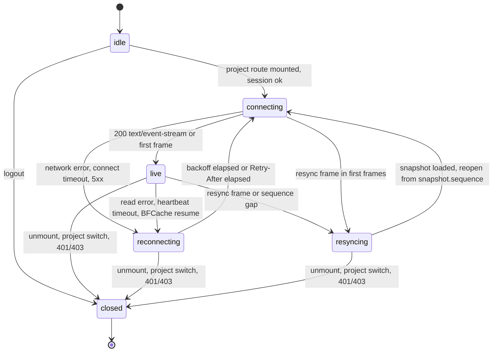
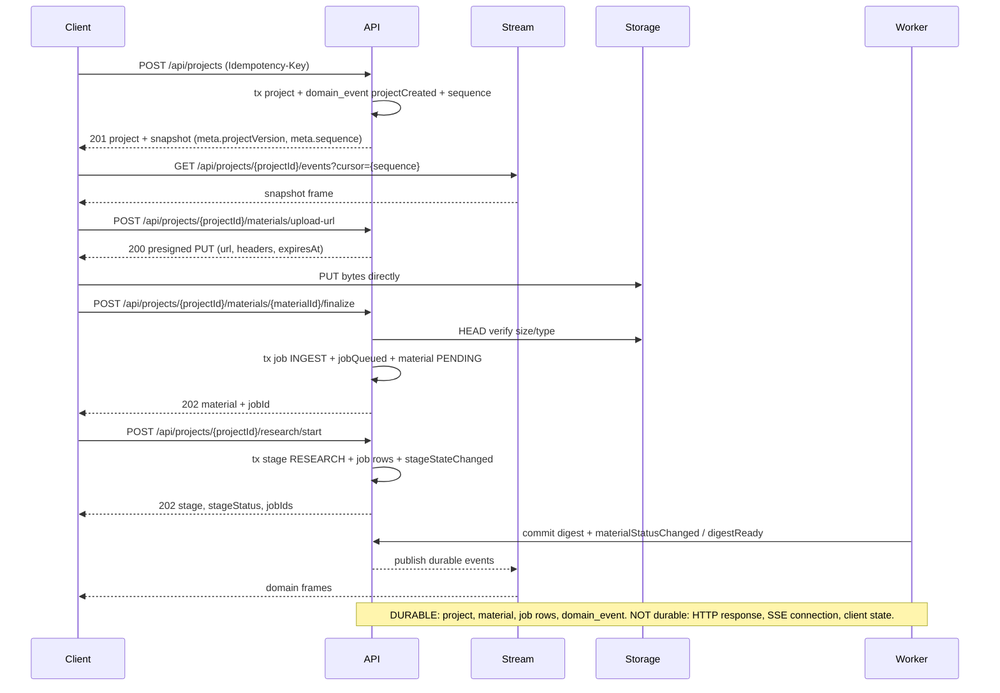
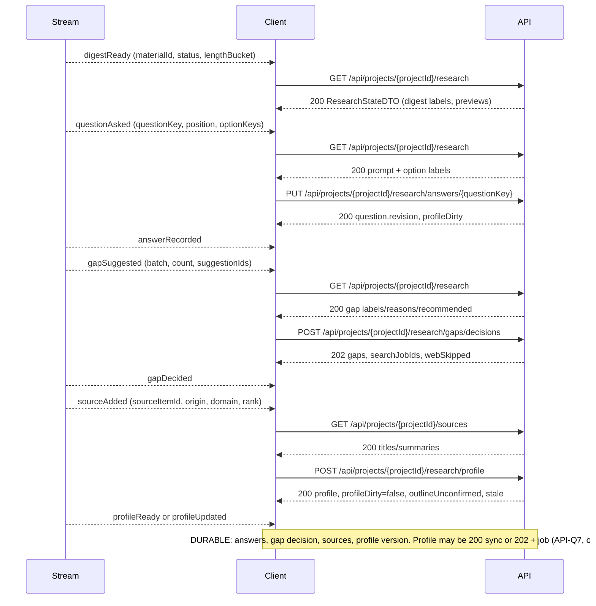
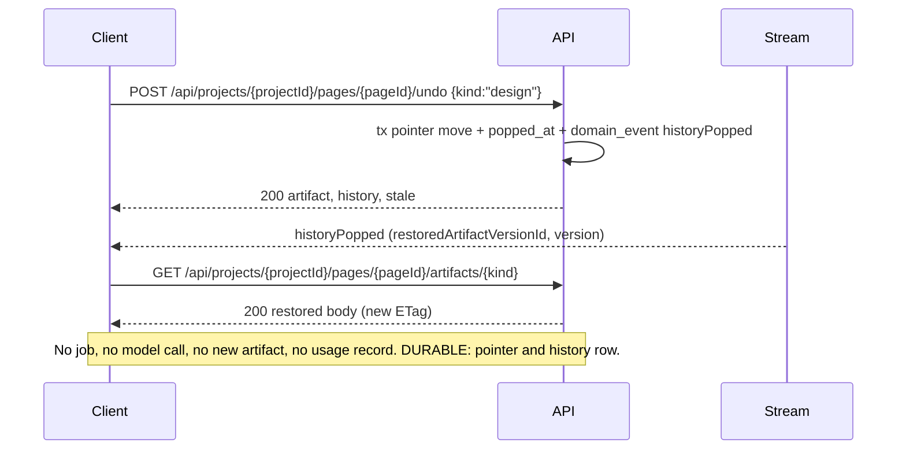

# Bound PPT · Frontend–Backend Boundary (v1.1)

> Version: v1.1 · 2026-11-19 · Status: Draft · Owner: Architecture + Frontend + Backend
> Wire source of truth: `docs/ppt-agent-api-contracts.md` (v1.1). State semantics: `docs/ppt-agent-architecture.md` (v1.1, §5/§6/§8–§10). Client implementation: `docs/ppt-agent-tech-stack.md` (v2.1, §5/§6/§9/§17). Field classification: `docs/ppt-agent-data-model.md` (v1.2, §7–§9). Behavior: `docs/ppt-agent-prd.md` (§7/§8.9/§11/§12). Interaction evidence: `docs/ppt-agent-interaction-flow.md` (§3/§6/§7).
> This document owns how the browser and the server divide work: who owns each state, what a command may assume, how projections converge, and what may cross the wire. It owns no product behavior, no state semantics of its own, and no new wire names. Every endpoint path, DTO field, enum value, event type, and `messageKey` below is copied from the API contracts; none is invented.

---

## 1. Document control

| Field | Value |
| --- | --- |
| Document / version / date | Bound PPT Frontend–Backend Boundary / v1 / 2026-11-19 |
| Status / owner / audience | Draft / Architecture + Frontend + Backend / frontend, backend, QA, security |
| Precedence | PRD (behavior, acceptance) > Architecture (ownership, state, consistency) > API contracts (wire names and semantics) > **this document** (boundary implementation) > FLOW/UX (evidence only) |
| Precedence inside this document | Where a wire name and a prose description disagree, the API contract name wins. Where this document and the API contract disagree on wire behavior, the API contract wins and this document is corrected. |
| Scope | Ownership matrix, command/query/event boundary, SSE lifecycle, optimistic reconciliation, content/metadata crossing, security boundary, failure ownership, cross-boundary sequences, contract-change gates |
| Out of scope | Prompt payloads, provider APIs, SQL schema, component structure, visual design, product decisions |
| Normative language | MUST / MUST NOT are gates. DEFAULT marks an implementation default changeable without a contract change. `[TBD-*]` marks an undecided item with owner and stage; it is not permission to invent. |

### 1.1 Terms on the boundary

| Term | Meaning on this boundary |
| --- | --- |
| **Server truth** | A row or derived value the server can rebuild and defend: project/stage, materials, answers, profile versions, outline versions, page identity, artifact versions/pointers/history, jobs, exports, idempotency records [ARCH §7.3; DATA §5.2]. |
| **Projection** | A server-derived, rebuildable view: stage status/reachability/stale reasons, page status, stale markers, counts, export progress [ARCH AD-4; DATA §8]. |
| **Command** | An intention-named mutation carrying `Idempotency-Key` and, for project scope, `X-Expected-Version` [API §2.5]. |
| **Query** | A side-effect-free `GET`. Never creates a job, never mutates state [API §1.1]. |
| **Event** | A content-free notice on the per-project stream. Durable events replay; ephemeral deltas do not [API §4.12]. |
| **Cursor** | The last applied durable per-project `sequence`; the only legal resume position [API §4.12]. |
| **Snapshot** | A consistent project read at a known `sequence`; the primary reconnect read [ARCH AD-10; API §4.2 P2]. |
| **Content / metadata** | Content is user prose and generated bodies (topic, names, material text, titles, summaries, profile prose, page bodies, files). Metadata is IDs, kinds, statuses, counts, buckets, domains, timings, costs [DATA §9.1]. |
| **Idempotency** | A client-generated intent key; duplicates replay the stored result and create no new job, artifact, event, or charge [API §2.8; DATA §7.5]. |
| **Fencing** | The attempt token a worker must match to commit. The client never sees or supplies it; it exists so a late result can be discarded [DATA §6.6, §7.1; TECH §9.5]. |
| **Optimistic version** | `project.version`, echoed as `meta.projectVersion`, compared via `X-Expected-Version` [API §2.8]. |

---

## 2. Purpose and boundary principles

The client is a rendering and intent-capture surface. It renders server projections, holds ephemeral view state, and sends commands. It does not compute workflow truth.

| # | Principle | Consequence on the boundary |
| --- | --- | --- |
| B-1 | **Server-authoritative workflow and state.** | Stage, gates, page status, stale markers, history pointers, job state, and export state are server rows or server computations [ARCH AD-1; PRD FR-7.9]. The client renders `StageStateDTO`, `PageSummaryDTO`, `ArtifactStatus`, and `ExportDTO`; it never writes them. It also never advances or completes anything on a timer. |
| B-2 | **The client is a projection plus ephemeral view state.** | Selected page, pinned page, modal, draft text, countdown, stage-nav focus are client-owned and must never be promoted to project state [ARCH §8.7; TECH §5.3]. |
| B-3 | **No fake success.** | `202` is acceptance, not completion. A page is done only with a server status backed by a current artifact; an export is done only after `exportDone` with a real artifact (`artifactId`, non-zero `byteSize`, `checksum`) [PRD FR-6.16; ARCH §10]. |
| B-4 | **Contracts are generated, not retyped.** | Pydantic → OpenAPI → `openapi-typescript`; event/body schemas → JSON Schema → TypeScript; CI fails on generated diffs [TECH §5.5]. Hand-written duplicate interfaces are a defect. |
| B-5 | **Durability is the job record, not the connection or an in-memory queue.** | Closing a tab, losing SSE, or restarting the process does not lose committed work [ARCH §8.2; TECH §9.3]. The client's only recovery duties are snapshot + cursor + same-key resend. |
| B-6 | **Content never crosses into events, logs, traces, or analytics.** | Event payloads carry IDs, counts, statuses, buckets, domains, timings, costs — never topic, material text, file names, full URLs, prompts, titles, summaries, profile prose, or page bodies [API §6; PRD NFR-PRIV-3]. |
| B-7 | **One writer per page; server-serialized structure.** | A second page mutation while a write is active returns the active job or `409 gate_violation` / `error.gate.page_write_in_progress` [API §2.8; ARCH §8.6]. Outline order and style are server-serialized; the client replaces optimistic order with the server response [API §2.8]. |

---

## 3. Ownership matrix

Classes: **SA** = server-authoritative; **SDP** = server-derived projection; **CE** = client ephemeral; **NCW** = never client-writable.

| Concern / field | Class | Authoritative owner | Client representation | Who may write / how it changes | Conflict behaviour |
| --- | --- | --- | --- | --- | --- |
| `ProjectDTO.stage` | SA | Project service | Current stage and nav state | Stage commands / gate transitions only; emitted with `stageStateChanged` [API §6] | Stale version → `409 conflict`; client refetches, never moves the stage locally |
| `ProjectDTO.version` | SA | Project service | `meta.projectVersion`, connection state | Exactly one increment per committed command, job completion, or artifact commit [API §2.8] | Client MUST NOT increment locally; mismatch → `error.conflict.stale_version` |
| `ProjectDTO.epoch` | SA | Project service | Restart fence | Incremented only by `POST /api/projects/{projectId}/restart` [API §4.2 P4] | Higher `epoch` in a snapshot/response → discard all ephemeral and optimistic state |
| `StageStateDTO.status` | SDP | Orchestrator projection | Stage badges, nav dots | Recomputed from jobs/artifacts/fingerprints; carried by `stageStateChanged` | Client replaces; never infers `COMPLETE`/`STALE` itself |
| `StageStateDTO.reachable` | SDP | Orchestrator gate computation | Nav enablement | Gate recomputation on every state change | Client replaces; a disabled stage is not clickable even if it has local content |
| `StageStateDTO.staleReasons` | SDP | Orchestrator | Reason text via stable codes | Recomputed from lineage/fingerprints [DATA §7.3] | Client displays codes; MUST NOT clear them locally after a rerun click |
| `StageStateDTO.blockers` | SDP | Orchestrator | Gate explanation next to the blocked control | Recomputed from gates | Client displays `code`/`messageKey`; never authors a blocker |
| `StageStateDTO.advanceToken` / `advanceTokenExpiresAt` | SA | Orchestrator | Held in memory only while a countdown runs | Issued only when auto-advance is eligible; ~30 s validity [API §4.5 O8] | Expired/invalid → `409 error.gate.token_expired`; client refetches stage state, never reuses a token |
| `MaterialDTO.status` | SA | Ingestion service | Chip state and progress | Ingestion job commit; `materialStatusChanged` | Client replaces from event/query; never marks `DIGESTED` optimistically |
| `MaterialDTO.displayName` | SA | Ingestion service | Chip label | Set at add time; no rename command in M1 | Client MUST NOT rewrite a chip label from a local draft |
| `MaterialListDTO.limit` / `remaining` | SDP | Config + material count | "N / limit" counter and add-disabled state | Server config and counts [PRD BR-7] | Client replaces; never hard-codes 6 |
| `SourcePanelDTO` items (`title`, `summary`, `domain`) | SA | Research service | Two grouped lists (materials / web) | `sourceAdded` then authoritative `GET /api/projects/{projectId}/sources` | Client refetches on `sourceAdded`; MUST NOT render a title from an event |
| `SourcePanelDTO` counts/status | SDP | Research service | Group headers, skeleton, empty state | Recomputed per research progress | Client replaces |
| Interview questions and answers (`prompt`, `options`, `optionKey`, `revision`) | SA | Research service | Current question card, "Recorded" summary | `PUT /api/projects/{projectId}/research/answers/{questionKey}`; one answer per identity [API §4.4 R3] | Server `question.revision` wins; older revisions discarded; prompt/options only from `GET /research` |
| `ProfileDTO` | SA | Research service | Profile card | `POST /api/projects/{projectId}/research/profile` | Client renders returned profile; never assembles profile prose |
| `profileDirty` | SDP | Orchestrator | "Needs update" banner; Outline blocked | Derived from profile existence vs later answer edits [API §3.5] | Client MUST NOT clear it locally; only a profile response/event with `profileDirty: false` clears it |
| Gap suggestions/decisions | SA | Research service | Gap card, immutable after profile | `POST /api/projects/{projectId}/research/gaps/decisions` | `409 error.gate.gaps_already_decided`; client offers restart/re-search per open API-Q1 |
| Outline versions (`OutlineDTO.version`) | SA | Artifact service | Sticky-note board | Generate/edit/move/insert/delete commands | Server returns the authoritative outline; client replaces order and titles |
| Page identity (`pageId`) | SA / NCW | Project service (`page`) | React keys and artifact query keys | Assigned by the server only [ARCH AD-11] | Client MUST NOT mint, reuse, or derive IDs from position |
| `OutlineDTO.confirmed` | SA | Orchestrator | Reconfirmation prompt | `POST /api/projects/{projectId}/outline/confirm`; any post-confirm outline edit sets it `false` [API §4.5.1] | Client MUST NOT auto-confirm; Plan/Design stay blocked until reconfirmed |
| Plan/design artifact body | SA | Artifact service | Wireframe / rendered canvas | Page job commit; pointer install is the commit point [DATA §7.1] | Client replaces from `pageJobDone` + `GET` artifact; never fabricates a version or a body |
| `ArtifactStatus.artifactVersionId`, `version` | SA | Artifact service | Status, history count, "V2" label | New artifact version per successful generation [ARCH §8.5] | Client displays server values; MUST NOT increment a variant on click |
| Current pointers (`plan`, `design`) | SA | Artifact service | What the canvas shows | Pointer install / undo | Client MUST NOT move a pointer; undo is a server command |
| History / undo (`canUndo`, `depth`) | SA | Artifact service | "Previous version" enabled state | `POST /api/projects/{projectId}/pages/{pageId}/undo`; `historyPopped` | Client MUST NOT pop a local stack or invent a restored version |
| Page status per kind (`plan`, `design`) | SDP | Orchestrator | Status text, icon, `aria-label` | Derived: error > active job > stale > done > pending [DATA §8.1] | Client renders; never derives `done` from elapsed time or a spinner |
| `ActiveJobRef` / job state | SA | Scheduler | Per-page/spinner context | Job rows; `jobQueued`, `pageJobStarted`, `jobResumed`, `pageJobDone` | Client joins by `jobId`; duplicate events are idempotent |
| Page stale marker | SDP | Orchestrator | Amber dot + `aria-label="needs rerun"` | Fingerprint diff [PRD §8.9.1] | Client displays and requests the stage's generate command per BQ-1; never clears |
| Cascade counts (`staleChanged.affectedPages`, `rerunPages`, `cascadeRatio`) | SDP | Orchestrator | Rerun summary | Emitted on stale recomputation | Client displays; MUST NOT recompute affected scope |
| `StyleSelectionDTO` (selected) | SA | Project service | Highlighted style card | `PUT /api/projects/{projectId}/style` | Server selection wins; highlight rolls back to returned `styleKey` |
| `StyleSelectionDTO.confirmed` | SA | Orchestrator | Confirm enabled; design gate | `POST /api/projects/{projectId}/style/confirm` | Client MUST NOT auto-confirm, including in fully automatic mode [PRD §7.4] |
| `ExportDTO.state` / `validation` | SA | Export service | Export modal progress/state and failed checks | Export job rows; `exportProgress`/`exportDone`/`exportFailed` | Client replaces; never advances state or downgrades a failure |
| `ExportArtifactDTO` | SA | Export service | Download affordance | Written only after the package exists, size > 0, checksum recorded [PRD FR-6.16] | Success UI requires non-null `artifact`; otherwise no success |
| Selected page / pinned page | CE | Client | Canvas focus; generation does not steal focus [PRD FR-6.3] | Local interaction only | Never sent as project state; never affects scheduling |
| Open modal / stage-nav focus | CE | Client | Dialog focus trap; roving focus | Local | Never calls a mutation by itself |
| Draft text / countdown state | CE | Client | Input values; countdown + Pause | Local; server has no timer [ARCH AD-9] | On 409, rebase only if still valid; on reconnect the countdown does not resume |
| Auth session | SA / NCW | Policy boundary | Cookie is invisible to JS | `POST /api/auth/login`, `POST /api/auth/logout` | `401 error.auth.session_required`; client clears caches and re-authenticates |

---

## 4. Truth versus projection lifecycle

### 4.1 Stage state machine on the server, reaction on the client

The server owns transitions S1–S14 [ARCH §8.1]. The client has exactly three reactions:

1. **Apply projection events.** On `stageStateChanged`, replace the matching entry from the payload (`stage`, `status`, `previousStatus`, `reachable`, `staleReasons`, `projectVersion`) and refresh the snapshot if `projectVersion` is newer [API §6].
2. **Invalidate the snapshot.** On any durable event carrying a newer `projectVersion`, or on a sequence gap, refetch `GET /api/projects/{projectId}/snapshot`; do not patch stage truth from unrelated events.
3. **React to a real stage change.** When `stage` differs from the previously applied stage, move focus to the stage heading, cancel the countdown, and abort the stage's generate affordance [PRD FR-7.11; FLOW §7.2].

The client MUST NOT implement transition guards. A disabled-looking control renders `reachable`; the server still rejects an illegal command with `409 gate_violation`.

### 4.2 Page status derivation

| Condition | Plan status | Design status |
| --- | --- | --- |
| Active job of that kind | `PLANNING` | `DESIGNING` |
| Last attempt failed, no current artifact | `ERROR` | `ERROR` |
| Current artifact, fingerprint matches | `DONE` | `DONE` |
| Current artifact, fingerprint differs | `STALE` | `STALE` |
| No artifact, no active/failed job | `PENDING` | `PENDING` |
| Page retired/deleted | not listed | not listed |

Precedence: error > active job > stale > done > pending [DATA §8.1; ARCH §8.3]. The client MUST render these values as received. It MUST NOT infer `DONE` from elapsed time, from a spinner, from the `202` itself, or from `pageJobDone` without a non-null `artifactVersionId`; MUST NOT show a final-looking wireframe for `PENDING` (skeleton instead [PRD FR-4.3]); MUST NOT show `STALE` as current; and MUST NOT treat a page-level `DONE` as stage `COMPLETE` (a page can be done while its stage is stale [API §4.6 PG1]).

### 4.3 Stale derivation

Staleness is a server fingerprint/lineage comparison [DATA §7.3; ARCH §8.4]. The boundary rules:

- The client displays stage stale from `StageStateDTO.status`/`staleReasons` and page stale from `ArtifactStatus.status` + `staleChanged`.
- The client never computes stale scope from local edits, never subtracts a page from `affected`, and never clears a marker after clicking "rerun". Only a new snapshot or a newer `staleChanged`/`stageStateChanged` may change what is displayed.
- `staleChanged.cause` is a display input: `OUTLINE_EDIT` and `OUTLINE_MOVE` may affect design only; a cross-section move affects plan and design; `PROFILE_UPDATE` requires outline reconfirmation before any plan rerun [PRD §8.9.1; API §3.10].
- If the client believes a stale artifact is visually current, the UI MUST say "needs rerun"; it MUST NOT silently render the old artifact as final.

### 4.4 History and undo

`POST /api/projects/{projectId}/pages/{pageId}/undo` with `{ "kind": "plan" | "design" }` is a pointer move: no job, no model call, no new artifact [API §4.7 PL5; ARCH §8.5]. The response returns `artifact`, `history`, and `stale`. The client requests undo and renders the returned artifact/history; it does not decrement a local variant or stack, and `history.canUndo`/`depth` are the only sources for the control state. Undoing a plan makes that page's design stale; undoing a design does not change the plan. `409 error.gate.nothing_to_undo` disables the control and is not retryable. A regenerate after undo creates a new version; the client MUST NOT resurrect a popped version on its own (no redo in M1 [ARCH AQ-4]).

### 4.5 Export success

Success is a two-part server fact: `exportDone` (or `GET /api/projects/{projectId}/exports/{exportId}` with `state: "SUCCEEDED"`) **and** a non-null artifact with positive `byteSize`, non-empty `checksum`, and a `downloadPath`. Until then the modal shows a non-success state. A `202` from `POST /api/projects/{projectId}/exports` only means a frozen deck snapshot was accepted [API §4.11 E1].

---

## 5. Command boundary

### 5.1 Headers

| Header | Direction | Required on | Boundary rule |
| --- | --- | --- | --- |
| `Cookie: bound_session=<opaque>` | request | Every authenticated route | HttpOnly; JS cannot read or attach it manually [TECH §6.4] |
| `Idempotency-Key` | request | Every command except `POST /api/auth/login` and `POST /api/auth/logout` | Client-generated per logical intent; reuse on transport retry; a different body with the same key is `422 error.validation.idempotency_key_reused` [API §2.4] |
| `X-Expected-Version` | request | Every project-scoped command | The last observed `project.version`; mismatch returns `409 conflict` and applies nothing [API §2.4] |
| `X-Request-Id` | request | Optional | Client correlation ID; echoed as `meta.requestId`; the server generates one when absent |
| `Idempotent-Replay` | response | Replayed duplicate | `true`; no new job/artifact/event/charge |
| `Retry-After` | response | `429`, `503` | Seconds; the client waits and retries with the same key |
| `ETag` | response | Artifact read | The artifact `contentDigest`; supports `If-None-Match` → `304` |

Missing required headers are `validation` (`error.validation.missing_header`), not a silent default [API §2.4].

### 5.2 Envelope and status semantics

Success: `{ ok, data, meta }`; `meta.projectVersion` is the authoritative version after the operation, `meta.sequence` the stream cursor at that point, `meta.idempotentReplay` true only on replay [API §2.6]. Error: `{ ok: false, error: { category, retryable, messageKey, details, requestId, traceId, retryAfterMs } }` [API §2.7]. `POST /api/projects` returns `201`; async acceptances return `202`; synchronous commands return `200`.

### 5.3 Admission order and client assumptions

Server order: authentication → project-scope authorization → rate-limit admission → schema validation → idempotency lookup → optimistic-version check → state + `domain_event` + `job` in one transaction → commit → response → runner wake [API §2.5; TECH §7.2].

| Observed response | The client MAY assume | The client MUST NOT assume |
| --- | --- | --- |
| `200` | The state change is committed and visible to subsequent reads; `meta.projectVersion` is current for that project | That derived artifacts already exist (a 200 confirm does not mean plan exists) |
| `201` | The project, its snapshot, and `projectCreated` are committed | That any later-stage resource exists |
| `202` | The intent is durable and a job/handle exists; progress arrives by event or query | Completion, success, an artifact, or a live connection to the terminal event |
| `400`/`422` | Validation failed; no state change | That retrying the same payload can succeed |
| `401`/`403` | Not authenticated / not authorized for this project | That the project does not exist (it may; do not probe) |
| `404` | The named resource/project is absent for this session | That a deleted ID is reusable |
| `409 gate_violation` | A prerequisite is missing; no state change | That retrying unchanged will pass |
| `409 conflict` | No state change; `details.currentVersion` names the current version | That the stale request should be replayed verbatim with a new version |
| `429`/`503` | Rate/provider admission rejected; retry later | That the command partially applied (it did not) |
| `5xx`/network error | Outcome unknown | Either applied or not applied; see §5.4 |

### 5.4 Idempotency-key lifecycle

| Situation | Key rule |
| --- | --- |
| First user intent (button press, Enter, drop) | Generate one UUID key and hold it in the mutation closure, not in render state |
| Transport retry (timeout, network error, `5xx`) or `429`/`503` after `Retry-After` | Reuse the same key and the identical body |
| `409 conflict` (stale version) | Refetch, rebase the payload if still valid, then use a **new** key (it is a new intent after reconcile) |
| User edits the input after a failure | New key |
| Duplicate click / double submit | Same key; the server returns the active job or stored result with `meta.idempotentReplay: true` |
| Same key, different body | Rejected `422 error.validation.idempotency_key_reused`; the client MUST NOT design a flow that does this |
| Key retention window | `[TBD-BE · backend, before pilot]` (API-Q4, ARCH AQ-11); the client MUST NOT assume keys expire at any particular time |

### 5.5 Optimistic version lifecycle

1. **Where the client gets the version.** `meta.projectVersion` from the latest successful response, or `ProjectSnapshotDTO.project.version` (equal to `meta.projectVersion` on the snapshot response).
2. **How it updates.** Replace, never increment: `version = response.meta.projectVersion` if present; otherwise `snapshot.project.version`. Job completion and artifact commits also bump it, so an `X-Expected-Version` based on a user-action count is wrong.
3. **Conflict handling.** On `409` / `error.conflict.stale_version` with `details.currentVersion`: refetch `GET /api/projects/{projectId}/snapshot` plus the specific resource (e.g. `GET /outline`), rebase only non-destructive local edits (title draft, tweak instruction text, topic text before first submit) if the target still exists and the intent still applies, then re-issue with `details.currentVersion` and a new key.
4. **Never auto-merge structure.** Reorder, insert/delete, cross-section move, and style change are server-serialized; the client replaces its optimistic order with the response [API §2.8; ARCH §8.6].
5. **Never fabricate a version.** The client MUST NOT send `currentVersion + 1` after a conflict, and MUST NOT treat a stale optimistic version as valid after any event with a higher `projectVersion`.

### 5.6 Retry ownership

| Layer | Owns | Boundary-visible effect |
| --- | --- | --- |
| Adapter (server-internal) | Small bounded transient retries inside one attempt; metered per call | None (no page/state change) [ARCH §10] |
| Scheduler | Cross-attempt retry/backoff, deadlines, lease expiry | `jobResumed`/`pageJobStarted` may repeat; no duplicate artifact |
| Orchestrator | User-initiated retry (`POST /api/projects/{projectId}/pages/{pageId}/retry`), new attempt/operation key | New job, no duplicate history or charge [API §4.7 PL4] |
| Client | Resubscribe with cursor; resend a pending intent with the same key after transport failure | It MUST NOT auto-resubmit generation, export, undo, delete, or restart |
| Client (forbidden) | Auto-generating a new intent or key after an ambiguous success | Would duplicate jobs/charges |

The client MAY show a "Retry" button; that button sends a new intent through the orchestrator command, not a revived old one.

### 5.7 Error presentation contract

| Category | HTTP | UI surface | Action | Example `messageKey` |
| --- | --- | --- | --- | --- |
| `validation` | 400/422 | Inline field error + focus | Fix input; no global toast as the only signal | `error.validation.empty_title` |
| `gate_violation` | 409 | Inline gate explanation at the blocked control + stage nav | Complete the prerequisite; offer restart where the API says so | `error.gate.material_locked` |
| `forbidden` | 401/403 | Session/access surface | Re-authenticate or leave the project | `error.auth.session_required` |
| `not_found` | 404 | Empty state or route-level not-found | Refetch; recreate only if the user asks | `error.not_found.outline` |
| `conflict` | 409 | Non-blocking banner ("updated elsewhere") | Auto-refetch and rebase (§5.5) | `error.conflict.stale_version` |
| `rate_limited` | 429 | Toast with `Retry-After` countdown | Wait; retry same key | `error.rate.limited` |
| `provider_timeout` | 504 | Page/job error card | User retries the page | `error.provider.timeout` |
| `provider_unavailable` | 503 | Degraded banner | User retries; no fabricated result | `error.provider.unavailable` |
| `parse_failure` | 422 | Failed material chip | Replace material or paste body text | `error.parse.url_unreachable` |
| `export_validation_failure` | 422 | Export modal failure panel | Retry / Try another format | `error.export.validation_failed` |
| `internal` | 500 | Error panel with correlation IDs | Retry once, then support | `error.internal.unexpected` |

Presentation rules: the client resolves `messageKey` from its own catalog and MUST NOT render server prose (the server never sends any [API §2.7]); every error surface shows `requestId` and exposes `traceId` for support copy; `details` is machine-readable and MUST NOT be stringified into the UI; the client MUST NOT echo user content into an error message (no topic, title, instruction, or file name) [PRD NFR-PRIV-3]; an unknown `messageKey` renders a generic message plus IDs and MUST NOT crash.

---

## 6. Query boundary

### 6.1 Roles

- **Snapshot** (`GET /api/projects/{projectId}/snapshot`) is the reconnect and convergence read: project, stages, pointers, counts, `profileDirty`, `materialLimit`, `activeJobs`, `latestExportId`, `sequence`, `schemaVersion` [API §3.3]. It is an authorized query and may carry `topic`/`name`; it never carries material text, source summaries, profile prose, outline titles, or page bodies.
- **Stage resources are content.** Research (`GET /research`), sources (`GET /sources`), outline (`GET /outline`), pages (`GET /pages`), artifacts (`GET /pages/{pageId}/artifacts/{kind}`), history, jobs, and exports each carry their own content/metadata mix.
- **Artifact bodies are versioned reads.** `ETag` is the artifact `contentDigest`; `If-None-Match` may return `304` [API §2.4, §4.6 PG2]. A `304` is valid only when the cached body belongs to the same `artifactVersionId`.

### 6.2 Caching rules (client)

| Query | Key | Invalidate on | Rule |
| --- | --- | --- | --- |
| Snapshot | project + `sequence` | Newer `projectVersion`/sequence, `resync`, epoch change | Source of projections; never hand-patched from unrelated events |
| Materials | project | `materialStatusChanged`, material mutation responses | Chip labels come from here, not from events |
| Research | project | `digestReady`, `questionAsked`, `answerRecorded`, `gapSuggested`, `gapDecided`, `profileReady`, `profileUpdated` | Prompts/options/labels are content |
| Sources | project | `sourceAdded`, `gapDecided` | Titles/summaries only from this query |
| Outline | project + outline version | `outlineDone`, any outline mutation response, `staleChanged`, `profileUpdated` | Structure is server-serialized |
| Pages | project + outline version | `pageJobStarted`, `pageJobDone`, `pageJobFailed`, `historyPopped`, `staleChanged`, `stageStateChanged` | Statuses are projections |
| Artifact / history | project + page + kind + `artifactVersionId` | Pointer change, undo, `pageJobDone` for same page/kind | Append-only per version; an older response MUST NOT overwrite a newer version; history is bounded |
| Job | project + `jobId` | Job events | Polling only as a stream-gap fallback [API §4.10 J1] |
| Export | project + `exportId` | `exportProgress`, `exportDone`, `exportFailed` | Success requires `artifact` |
| Styles / auth me | catalog version / session | Explicit refresh / `401` | Catalog TTL DEFAULT 5 minutes; auth cache cleared on logout or expiry |

DEFAULT cache policy: project data is never served from a service worker or local database [TECH §5.1]; SSE events invalidate rather than patch content; `staleTime` is 0 for content queries while generating; artifact bodies may be retained by `artifactVersionId` for the session.

### 6.3 What may be optimistic and what must wait

Optimistic local echo is permitted only for text the user is still authoring (title draft, topic field, tweak instruction) and non-authoritative visual affordances (pending chip row, reorder preview, selection highlight). Everything that changes server truth — stage, outline order, page identity, artifact pointer, history, style confirmation, export state, delete, restart, profile — MUST wait for the response or event (§9).

### 6.4 Multi-tab

Two tabs share one server truth. Each tab owns its SSE connection, cursor, Zustand view state, and Query cache. The second tab receives the same durable events and MUST converge by the same invalidation rules, not by reading the first tab's memory. `localStorage` MUST NOT hold project truth (outline, answers, stage, stale, history); cross-tab state sync is not a truth mechanism. A stale `X-Expected-Version` in the second tab produces `409 conflict`; that tab refetches and rebases. Restart/delete in one tab produces a new `epoch`/404 in the other on its next query or event; the other tab MUST discard ephemeral and optimistic state.

### 6.5 BFCache, refresh, and project switch

On `pageshow` with `persisted: true`, on `visibilitychange` to visible after a gap, or on any reload, the client MUST re-read the snapshot, then resume SSE from the snapshot sequence (not from a remembered stage object). In-memory stage, page status, and job progress MUST NOT be trusted after restore; only the snapshot and subsequent events are. Switching projects aborts the old SSE connection and clears that project's query cache; cursors are per project and MUST NOT be reused across projects. Polling is never the primary mechanism; it is a gap fallback only (§8) [ARCH AD-10].

---

## 7. Event boundary

### 7.1 Durable versus ephemeral

| Class | Examples | Replay | Cursor | Client rule |
| --- | --- | --- | --- | --- |
| Durable `domain` frame | All API §6 types except `outlineDelta` | Yes, in `sequence` order | Advances `sequence` | Apply at most once; dedupe by `sequence` and `eventId` |
| `snapshot` frame | Projection at a sequence | On demand | Sets baseline | Replace snapshot; then apply later durable frames |
| `ephemeral` frame | `outlineDelta` | No | Never | Render partial notes only; discard on `outlineDone`/failure/reconnect |
| `heartbeat` | Liveness | No | Never | Reset liveness timer only |
| `resync` | Gap notice | No | Resets baseline | Reload snapshot before applying anything later |

Content-free rule: durable payloads carry IDs, counts, statuses, buckets, domains, timings, and costs only [API §6]. The client MUST NOT expect a label, title, summary, or body in any durable event.

### 7.2 Events that require a query refetch to render

| Event | Carries | Refetch required to render |
| --- | --- | --- |
| `materialStatusChanged` | `materialId`, `kind`, `status`, `errorCode?`, `pageCountBucket?` | `GET /api/projects/{projectId}/materials` for `displayName`, MIME, size |
| `sourceAdded` | `sourceItemId`, `origin`, `sourceType`, `domain`, `rank`, IDs | `GET /api/projects/{projectId}/sources` for `title`, `summary` |
| `digestReady` | `materialId`, `status`, `lengthBucket`, `extractedCharBucket` | `GET /api/projects/{projectId}/research` for `summaryPreview` and digest labels |
| `questionAsked` | `questionKey`, `position`, `optionKeys` | `GET /api/projects/{projectId}/research` for `prompt` and option labels |
| `gapSuggested` | `batch`, `count`, `recommendedCount`, `suggestionIds` | `GET /api/projects/{projectId}/research` for `label`, `reason` |
| `profileReady` / `profileUpdated` | version IDs and counts | `GET /api/projects/{projectId}/research` for profile prose |
| `outlineDone` | version, page/section counts, deviation | `GET /api/projects/{projectId}/outline` for titles/key points |
| `pageJobDone` | `pageId`, `kind`, `artifactVersionId`, `version`, `historyDepth` | `GET /api/projects/{projectId}/pages/{pageId}/artifacts/{kind}` for the body |

The client MUST render an ID-keyed placeholder (skeleton, count, badge) until the refetch resolves; it MUST NOT fabricate a human label from an ID.

### 7.3 Cursor, replay, resync, ordering

- The cursor is the last applied durable `sequence`. Ephemeral frames do not advance it [API §4.12].
- Reconnect sends `?cursor={sequence}`. `Last-Event-ID` is accepted only when `cursor` is absent [TECH §6.3]; the client sends one, not both.
- Apply only `sequence === lastApplied + 1`. A larger number is a gap → `resyncing` (§8), not an out-of-order apply. A smaller or equal number is a duplicate → ignore.
- Dedupe additionally by `eventId` (UUID) because a replay and a live frame can describe the same event [API §4.12].
- Unknown event types MUST be ignored without breaking the stream; the cursor still advances. Unknown payload fields are ignored. An unknown enum renders a neutral fallback and triggers a snapshot refetch [API §2.3].
- `resync` means the client MUST reload the snapshot before applying any later frame; it MUST NOT continue from the old cursor [API §4.12].
- A slow-subscriber disconnect/resync is normal, not fatal; the client reconnects with its last applied sequence.
- Heartbeat every 15 s; DEFAULT 35 s without any frame means a dead connection.

### 7.4 Event → client action

| Event | Client action |
| --- | --- |
| `projectCreated` | No-op if it matches the current project; otherwise invalidate the project-level view (M2 list is out of scope) |
| `materialStatusChanged` | Invalidate materials; update chip status from payload; refetch labels; refresh snapshot counts |
| `sourceAdded` | Invalidate sources (and research); append an ID-keyed placeholder until the refetch resolves |
| `digestReady` | Invalidate research; update digest status/bucket from payload; refetch previews |
| `questionAsked` | Invalidate research; reveal the question card only after prompt/options load |
| `answerRecorded` | Invalidate research; accept `profileDirty` only if the event revision is not older than the rendered one |
| `gapSuggested` | Invalidate research; render suggestion cards only from the refetched query |
| `gapDecided` | Invalidate research/sources; disable gap editing once a decision/profile exists |
| `gapSearchCompleted` | Invalidate research/sources; render per-gap `RESULTS`/`ZERO_RESULTS`/`FAILED`; no query text in the event |
| `profileReady` | Invalidate research + snapshot; enable outline generation subject to `stages[]` |
| `profileUpdated` | Invalidate research, outline, snapshot; show outline reconfirmation |
| `outlineDelta` | Append to the ephemeral reducer; never write Query cache or local storage |
| `outlineDone` | Discard deltas; invalidate outline, pages, snapshot; no success toast before the query resolves |
| `stageStateChanged` | Update the `stages[]` entry from payload; refetch snapshot if `projectVersion` is newer; cancel countdown on stage change |
| `staleChanged` | Invalidate pages/outline/snapshot; show rerun markers and affected counts; never clear locally |
| `pageJobStarted` | Update that page/kind status to `PLANNING`/`DESIGNING`; invalidate pages if the page is unknown |
| `pageJobDone` | Invalidate pages and that page's artifact/history; require `artifactVersionId`; refetch the body |
| `pageJobFailed` | Invalidate pages; render `errorCode`/`errorCategory`/`retryable`; offer user-initiated retry only |
| `historyPopped` | Invalidate artifact/history/pages for that page/kind |
| `jobQueued` | No page-status change; optional queued indicator |
| `jobCancelled` | Invalidate pages/job; server re-derives the page status |
| `jobResumed` | Invalidate the job query if visible; do not duplicate page entries |
| `exportProgress` | Update the modal progress from payload metadata only |
| `exportDone` | Invalidate export; render success only after the query returns a non-null `artifact` |
| `exportFailed` | Invalidate export; keep the modal open; render `failedPageIds` and validation checks |

### 7.5 Outline delta handling

`outlineDelta` is the only content-bearing stream frame and it is ephemeral [API §6]. The client keeps partial notes in a reducer keyed by `jobId`; a `chunkIndex` not greater than the last applied index for that job is ignored. On `outlineDone`, job failure, project switch, reconnect, `resync`, or epoch change, partial state is discarded and the committed outline is loaded. Partial notes MUST NOT be editable, counted, confirmed, or persisted; the board becomes interactive only from `GET /outline`.

---

## 8. SSE connection lifecycle



| Failure | Detection | Action |
| --- | --- | --- |
| Connect refused / offline | `fetch` rejects, `navigator.onLine === false` | `reconnecting`, backoff with jitter; resume on `online` |
| Connect timeout | DEFAULT 10 s without response headers | Abort and `reconnecting` |
| HTTP 401 | Response status | Pause; probe `GET /api/auth/me` once; if 401 → session expiry → `closed` + login; if 200 → reconnect |
| HTTP 403 / 404 | Response status | `closed`; access or project-not-found route; clear project cache; do not loop |
| HTTP 429 / 503 | Response status + `Retry-After` | Wait at least `Retry-After`, then reconnect |
| Other 5xx | Response status | `reconnecting` with backoff |
| Heartbeat timeout | DEFAULT 35 s without any frame | Abort stream; `reconnecting` |
| `resync` frame | Frame parse | `resyncing`; `GET /snapshot`; reopen at `snapshot.sequence` |
| Sequence gap | `sequence > lastApplied + 1` | `resyncing` (same as above) |
| Duplicate sequence/eventId | Frame parse | Ignore; keep cursor |
| Unknown event type/enum | Frame parse | Ignore unknown type; neutral render + snapshot refetch for unknown enum |
| Slow consumer disconnect | Stream ends without a terminal frame | `reconnecting`; send last applied sequence |
| Tab restored from BFCache | `pageshow` with `persisted` | Force snapshot + reconnect; drop in-memory stage trust |
| Project switch | Route change | Abort controller; `closed`; clear per-project cache |
| Tab unmount | Route unmount | Abort controller; `closed`; jobs continue server-side |
| Logout | User action | `closed`; clear all project caches and queries |

Backoff DEFAULT: 1 s base, doubling, 30 s cap, full jitter; reset after 10 s live. The client MUST honor `Retry-After` over its own backoff, MUST NOT open a second stream for the same project in one tab, and MUST abort the previous `fetch` before reconnecting.

---

## 9. Optimistic UI and reconciliation

| Interaction | Optimistic? | Immediate render | Confirm signal | On failure | Server field that wins |
| --- | --- | --- | --- | --- | --- |
| Project name / topic / title / tweak drafts | Yes, local text only | Input value | The corresponding command returns 200/202 | Inline error; keep draft; rebase only if still valid | `project.name` / `project.topic` / `outline.pages[].title`; submitted instruction |
| Reorder preview | Visual only | Moved note | `POST /api/projects/{projectId}/outline/pages/{pageId}/move` 200 | Restore server order; toast | `outline.pages[].position` |
| Chip add (paste/url/file) | Pending row only | Skeleton chip with no ID | `202` `material` + `jobId` | Remove pending row; show error | `materialId` + `MaterialDTO` |
| Chip remove | Yes, fade | Chip disappears | `DELETE /api/projects/{projectId}/materials/{materialId}` 200 | Restore chip | `removed`, `stale` |
| Answer selection | Yes, highlight | Option selected | `PUT /api/projects/{projectId}/research/answers/{questionKey}` 200 | Restore previous option | `question.revision` |
| Gap toggle / "not needed" | Local only | Checkbox state | `POST /api/projects/{projectId}/research/gaps/decisions` 202 | Restore prior selection | `GapStateDTO.decision` |
| Style highlight | Yes, highlight | Card selected | `PUT /api/projects/{projectId}/style` 200 | Restore prior style | `styleSelection.styleKey` |
| Page pin / countdown pause | Yes | Pin holds; timer stops | Local only | N/A | None (client-only; no server timer) |
| Generate outline / plan / design | No artifact | Queued/pending shell from `202` | `pageJobDone` / `outlineDone` + query | Page error card; no auto-retry | `ArtifactStatus` / `artifactVersionId` |
| Regenerate / tweak | No | "Generating" on that page | `pageJobDone` with new `version` | Unchanged current/history | `ArtifactStatus.version` |
| Undo | No pointer move | Button busy | `200` artifact/history | Unchanged current | `artifact`, `history` |
| Delete outline page | No removal | Pending state | `200` outline + stale | Page remains | `OutlineDTO.pages` |
| Profile update | No prose | Button busy | `200` profile (+ `outlineUnconfirmed`) | Keep dirty banner | `ProfileDTO`, `profileDirty` |
| Export | No progress invention | Modal "Queued" | `exportProgress` then `exportDone` + artifact | Failure panel; modal stays | `ExportDTO.state`, `artifact` |
| Restart | No reset | Confirm modal only | `202` snapshot | Keep project; show error | New `epoch`, snapshot |
| Project delete | No removal | "Deleting" route state | `202`; later `404` | Re-enable project if 4xx | `status: "DELETING"`, then 404 |

The client MUST NOT show a variant increment, history count, stale clearance, or success state from an optimistic update.

---

## 10. Content versus metadata boundary

### 10.1 Classification of boundary values

| Value | Class | SSE events | Logs/traces | Analytics | Authorized query |
| --- | --- | --- | --- | --- | --- |
| Project `topic`, `name` | Content | Prohibited | Prohibited | Prohibited | Snapshot / project responses |
| Material `displayName`, file name | Content | Prohibited | Prohibited | Prohibited | `GET /materials` |
| Material text, normalized text | Content | Prohibited | Prohibited | Prohibited | Never direct; digests only |
| Source `title`, `summary` | Content | Prohibited | Prohibited | Prohibited | `GET /sources`, `GET /research` |
| Full URL (`source_url`) | Content | Prohibited | Prohibited | Prohibited | Not returned; `domain` only |
| Digests, question prompts/labels, gap labels/reasons, profile prose | Content | Prohibited | Prohibited | Prohibited | `GET /research` |
| Outline `title`, `keyPoints`; page/design body | Content | Prohibited | Prohibited | Prohibited | `GET /outline`; `GET .../artifacts/{kind}` |
| Tweak instruction | Content | Prohibited | Prohibited | Prohibited | Stored as a restricted reference [DATA §6.6]; never returned |
| Export file bytes / file name | Content | Prohibited | Prohibited | Prohibited | `302` download |
| IDs (`projectId`, `pageId`, `jobId`, `artifactId`, `eventId`) | Metadata | Allowed | Allowed | Allowed (pseudonymous) | Everywhere |
| Statuses, phases, enum values | Metadata | Allowed | Allowed | Allowed | Everywhere |
| Counts, totals, rankings, `historyDepth`, `pageCount` | Metadata | Allowed | Allowed | Allowed | Everywhere |
| Buckets (`lengthBucket`, `pageCountBucket`, `extractedCharBucket`) | Metadata | Allowed | Allowed | Allowed | Everywhere |
| `domain` | Metadata | Allowed | Allowed | Allowed | Everywhere |
| Timings, retry counts, `cascadeRatio`, `percent` | Metadata | Allowed | Allowed | Allowed | Everywhere |
| Costs / token counts | Metadata | Allowed | Allowed | Allowed | Server-side only in M1 API |
| `optionKey`, `questionKey`, `styleKey` | Metadata (keys, not labels) | Allowed | Allowed | Allowed | Everywhere |
| Error `category`, `messageKey`, `details` | Metadata | Allowed | Allowed | Allowed | Error envelope |

### 10.2 Signed URLs and downloads

- Presigned upload URLs are returned only from `POST /api/projects/{projectId}/materials/upload-url`; they are short-lived, method/header-bound, and MUST NOT be logged or shared across projects [API §4.3 M4; TECH §8.3].
- The browser uploads bytes directly to storage; bytes MUST NOT transit the API process [TECH §8.3]. `finalize` is mandatory: the server HEADs the object and verifies actual size/type before enqueueing `INGEST` [API §4.3 M5].
- Download uses `GET /api/exports/{exportId}/download` → `302 Location: <signed URL>`; the signed URL is never in JSON, and object keys never reach the browser [API §4.11 E3].
- Page images/charts use `GET /api/projects/{projectId}/assets/{assetId}` → `302` after a project-scope and artifact-reference check. The artifact body stores only the stable asset path/ID, never a signed URL, so immutably cached bodies cannot expire [API §4.6 PG4].
- Style `previewUrl` is a short-lived authorized URL; it MUST NOT be logged or reused across tenants [API §3.8]. Error `details` MUST NOT contain a URL, object key, file name, prompt, or page body [API §2.7].

### 10.3 Client analytics

The client MUST NOT send project content to any analytics, session-replay, or error-reporting SDK. Permitted correlation data is limited to `projectId`, `jobId`, `pageId`, `requestId`, `traceId`, statuses, counts, timings, and `messageKey` [PRD §11.5, §11.6]. Session replay that captures DOM containing titles, summaries, profile prose, or page bodies is forbidden unless every content region is masked and a privacy review records it `[TBD-BIZ · legal, M1]` (PRD-08). Client events are never the source for cost, quota, billing, or published metrics [PRD §11.1].

---

## 11. Security boundary

| Control | Boundary rule |
| --- | --- |
| Session cookie | Opaque token, `HttpOnly`, `Secure` in production, `SameSite=Lax`, `Path=/` [TECH §6.4]. The client MUST NOT read, copy, or store a token in `localStorage`, `sessionStorage`, memory, or a URL |
| CSRF | Same-origin SPA; mutating routes also verify origin [TECH §14]. The client MUST NOT add a custom auth header as a workaround |
| 401 handling | Stop commands, abort SSE, clear project caches, probe `GET /api/auth/me` once, then route to sign-in with a return path. No silent retry loop |
| Project authorization and tenant scope | Every command/query is scoped by the session's project authorization. The client sends only the `{projectId}` it received; a tampered or guessed ID returns `404`/`403` and the client MUST NOT probe alternatives. There is no client-side account/tenant switcher in M1 [ARCH AD-14] |
| Consent and notice | The client fetches `GET /api/policy/notices`, shows the required notice before the first material, and posts `POST /api/policy/consent`. The server enforces `error.gate.consent_required`; the client MUST NOT cache an accepted state without a server record [API §4.1 A5/A6] |
| Client configuration | `GET /api/config` carries only non-secret limits/types/formats/canvas. Server values are authoritative; the client MUST NOT hard-code the prototype's six-material demo limit [API §4.1 A4] |
| Upload | Server validates extension/MIME/size/quota/consent before signing; finalize re-verifies size/type (`error.parse.type_mismatch`); the client MUST NOT bypass `finalize` or claim upload success before `202` |
| SSRF / parsing | Server-side only; the client MUST NOT fetch material URLs directly or display fetched source text from an origin it fetched itself |
| Rendered content | User and web text is escaped by React; no `dangerouslySetInnerHTML` with user-derived content; exported HTML is sanitized server-side (`nh3`) [TECH §12.5]. The client sanitizes nothing as a substitute for server sanitization. Server errors are content-free and the client MUST NOT enrich them with local content |
| CSP | Nonce-based strict policy; `connect-src` limited to app/API and required telemetry endpoints; no `unsafe-eval` in production [TECH §14]. A CSP violation MUST NOT be worked around by inlining scripts |
| Secrets | No provider, storage, or database key is ever in the bundle; no model/search call originates in the browser [TECH §10.3] |
| Deletion | After `DELETE /api/projects/{projectId}` → `202`, the project is inaccessible; the client MUST clear its cache and MUST NOT serve cached pages as if the project still existed |

---

## 12. Failure ownership matrix

| Failure class | Detects | Retries | Client-visible state | Invariant | API contract |
| --- | --- | --- | --- | --- | --- |
| Material parse failure | Ingestion job | No auto-repeat; user replaces/pastes | Chip `FAILED` "not digested"; others continue | One material isolated [PRD FR-1.9] | `materialStatusChanged` `errorCode`; `error.parse.type_mismatch` |
| URL fetch failure | Ingestion adapter | No auto-repeat | Failure + "paste the body text"; other sources kept | No fabricated source [PRD FR-1.10] | `error.parse.url_unreachable` |
| Search zero results / outage | Search adapter | No for zero; bounded for outage | "Nothing found; continue or adjust gaps" / degraded material-only scope | No silent skip, no fabricated source [PRD FR-2.10; ARCH §10] | `gapSearchCompleted` with `ZERO_RESULTS`; `provider_unavailable` |
| Page generation failure | Generation job | Orchestrator (user retry) only | Page `ERROR` + Retry; others continue | No history/current change; no success [PRD FR-4.8] | `pageJobFailed` |
| Provider timeout | Gateway | Adapter bounded; scheduler cross-attempt | Page error + Retry, or job still running | No success claim [PRD NFR-REL-3] | `provider_timeout`, `error.provider.timeout` |
| Worker crash / deploy | Lease expiry + reconciler | Scheduler requeues; fencing blocks late commit | Page still `PLANNING`/`DESIGNING`, then converges | No duplicate artifact or history [ARCH §8.2] | `jobResumed` / `pageJobStarted` |
| Client disconnect | Client stream | Client resubscribes | "Reconnecting" banner; page states unchanged | Jobs continue [PRD FR-7.5] | `resync` on return |
| Stream gap / expired cursor / slow consumer | Client sequence check / `resync` / server queue bound | Client snapshot + reconnect | Brief resync state | No silent divergence [ARCH AD-10] | `resync` frame |
| Queue full (dispatch) | Runner | Reconciler re-wakes committed job | Longer queued state | Committed job never lost [TECH §9.4] | `jobQueued` |
| Export validation failure | Export service | User: Retry / another format | Modal stays open; failed checks + page IDs | No success without artifact [PRD FR-6.15] | `exportFailed` |
| Export assembly / subprocess crash | Export subprocess + parent | User-initiated new intent | Failure reason; no file | No zero-byte artifact; API unaffected [PRD FR-6.16; TECH §9.9] | `exportFailed`, `error.export.validation_failed` |
| Deletion partial | Deletion job/sweeper | Server sweeper | `DELETING`; later `404` | No resurrection; ledger content-free [PRD FR-8.2] | `202` then `404 error.not_found.project` |
| Restart mid-job | Epoch/fencing | Scheduler cancels; old results discarded | New snapshot, new `epoch` | No old-epoch artifact becomes current [ARCH §6.10] | `cancelledJobIds`, new snapshot |
| Duplicate click | Server idempotency | Replay | Active job/result; no second entry | No duplicate charge/history [PRD NFR-REL-3] | `meta.idempotentReplay: true` |

---

## 13. Sequence diagrams

### 13.1 Create project, add materials, start research



### 13.2 Research: digest → questions → gaps → search → profile



### 13.3 Outline: generate/stream → edit → confirm → countdown → advance

```mermaid
sequenceDiagram
  Client->>API: POST /api/projects/{projectId}/outline/generate
  API-->>Client: 202 jobId, outlineVersionId null
  Stream-->>Client: ephemeral outlineDelta (no id, not replayable)
  Client->>Client: render partial notes (discardable)
  Stream-->>Client: outlineDone (outlineVersionId, pageCount, sectionCount, deviation)
  Client->>API: GET /api/projects/{projectId}/outline
  API-->>Client: 200 OutlineDTO (titles, key points)
  Client->>API: PATCH /api/projects/{projectId}/outline/pages/{pageId}
  API-->>Client: 200 outline (confirmed=false if it was true) + stale (design only)
  Stream-->>Client: staleChanged
  Client->>API: POST /api/projects/{projectId}/outline/confirm
  API-->>Client: 200 outline, stage, snapshot (advanceToken when eligible)
  Client->>Client: 3 s countdown; edit/pause cancels; token kept in memory
  Client->>API: POST /api/projects/{projectId}/stages/advance {fromStage, advanceToken}
  API-->>Client: 200 AdvanceResultDTO
  Note over Client,API: DURABLE: outline version, confirmed flag, advance. Client countdown is not durable and never advances on its own.
```

### 13.4 Plan/design fan-out, inspect while generating, reconnect mid-generation

```mermaid
sequenceDiagram
  Client->>API: POST /api/projects/{projectId}/plan/generate
  API-->>Client: 202 jobs[], skippedPageIds, counts
  Stream-->>Client: pageJobStarted per page
  Client->>API: GET /api/projects/{projectId}/pages
  API-->>Client: 200 PageListDTO statuses
  Client->>API: GET /api/projects/{projectId}/pages/{pageId}/artifacts/{kind}
  API-->>Client: 200 ArtifactDTO + ETag
  Stream-->>Client: pageJobDone (artifactVersionId, version, historyDepth)
  Client->>API: POST /api/projects/{projectId}/design/generate
  API-->>Client: 202 jobs[] (reused pages skipped)
  Note over Client,Stream: stream drops; jobs continue server-side
  Client->>API: GET /api/projects/{projectId}/snapshot
  API-->>Client: 200 snapshot at sequence S
  Client->>Stream: GET /api/projects/{projectId}/events?cursor={lastApplied}
  Stream-->>Client: replay + live durable frames
  Client->>API: GET /api/projects/{projectId}/pages
  API-->>Client: 200 converged statuses
  Note over API,Stream: DURABLE: job rows, artifact versions/pointers, domain_event. Client page lock/pin is ephemeral.
```

### 13.5 Undo the previous version



### 13.6 Stale rerun on stage entry: R1 versus R3/R7

```mermaid
sequenceDiagram
  Client->>API: PATCH /api/projects/{projectId}/outline/pages/{pageId} {title}
  API-->>Client: 200 stale {plan:[], design:[pageId]}
  Stream-->>Client: staleChanged cause OUTLINE_EDIT
  Client->>API: POST /api/projects/{projectId}/design/generate
  API->>API: fingerprint diff; schedule design for one page only
  API-->>Client: 202 jobs[one page], skippedPageIds
  Client->>API: POST /api/projects/{projectId}/outline/pages/{pageId}/move {toSectionKey}
  API-->>Client: 200 stale {plan:[pageId], design:[pageId]}
  Client->>API: POST /api/projects/{projectId}/plan/generate
  API-->>Client: 202 jobs[pageId]
  Client->>API: POST /api/projects/{projectId}/research/profile
  API-->>Client: 200 profile, outlineUnconfirmed=true, stale
  Client->>API: POST /api/projects/{projectId}/outline/generate
  API-->>Client: 202 jobId
  Stream-->>Client: outlineDone, then reconfirm required
  Client->>API: POST /api/projects/{projectId}/outline/confirm
  Client->>API: POST /api/projects/{projectId}/plan/generate
  Note over API,Stream: R1/R2 are chrome-only (0 model jobs); R3/R4/R7 are diff-scoped by the server. DURABLE: staleChanged and the job rows.
```

### 13.7 Export: snapshot → validation → package → download

```mermaid
sequenceDiagram
  Client->>API: POST /api/projects/{projectId}/exports {format:"PPTX"}
  API->>API: freeze deck snapshot; tx export job
  API-->>Client: 202 ExportDTO state QUEUED
  Stream-->>Client: exportProgress (phase, pagesRendered, pagesTotal, percent)
  alt validation fails
    Stream-->>Client: exportFailed (failedPageIds, validationResult)
    Client->>Client: keep modal open; Retry or Try another format
  else success
    Stream-->>Client: exportDone (artifactId, byteSize, checksum, expiresAt)
    Client->>API: GET /api/projects/{projectId}/exports/{exportId}
    API-->>Client: 200 ExportDTO with artifact
    Client->>API: GET /api/exports/{exportId}/download
    API-->>Client: 302 Location signed URL (no-store)
  end
  Note over API: DURABLE: export job, validation report, package metadata. Success requires a real non-zero artifact.
```

### 13.8 Conflict and gap: duplicate click, stale version, stream gap

```mermaid
sequenceDiagram
  Client->>API: POST /api/projects/{projectId}/pages/{pageId}/design/regenerate (key K1)
  Client->>API: POST /api/projects/{projectId}/pages/{pageId}/design/regenerate (key K1 duplicate click)
  API-->>Client: 200 active job + Idempotent-Replay: true (no second job)
  Client->>API: PATCH /api/projects/{projectId}/outline/pages/{pageId} (X-Expected-Version 11)
  API-->>Client: 409 error.conflict.stale_version details.currentVersion 13
  Client->>API: GET /api/projects/{projectId}/snapshot
  API-->>Client: 200 version 13
  Client->>API: PATCH /api/projects/{projectId}/outline/pages/{pageId} (version 13, new key K2)
  API-->>Client: 200 outline + stale
  Note over Client,Stream: stream gap detected
  Stream-->>Client: resync (reason, snapshotAvailable, latestSequence)
  Client->>API: GET /api/projects/{projectId}/snapshot
  API-->>Client: 200 snapshot
  Client->>Stream: GET /api/projects/{projectId}/events?cursor={snapshot.sequence}
  Stream-->>Client: live durable frames
  Note over Client,API: Same key only for the same body and transport retry; a reconciled intent uses a new key.
```

---

## 14. Contract change management

| Change | Rule | Client obligation |
| --- | --- | --- |
| Additive response field | Allowed without a version bump [API §2.2] | Ignore unknown fields |
| Additive event payload field | Allowed; does not bump `schemaVersion` [API §9] | Ignore unknown fields |
| New event type | Allowed | Ignore without breaking the stream |
| New enum value or `messageKey` | Allowed | Neutral fallback / generic message with IDs, then refetch snapshot [API §2.3] |
| Field removal/rename, retyped field, changed error category for a code, removed enum value | Breaking | Requires `/api/v2` or an explicit migration approved by both owners; the client MUST NOT depend on a field the contract has not frozen |
| Event payload field removal/rename/retype | Breaking for that event type; bumps its `schemaVersion` | Coordinated client release |
| New required command field | Only with a default or a new endpoint [API §9] | Never send an undeclared field and rely on it |
| `schemaVersion` semantics | Per project, per artifact, and per event type; independent of `project.version` [DATA §11] | Never compare `schemaVersion` to `project.version` |

Generation gates: `npm run gen:api` writes `frontend/src/api/schema.d.ts` from `/openapi.json`; `npm run gen:shared` writes TS from `shared/schemas/`; CI fails on a committed diff [TECH §5.5]. MSW fixtures MUST be typed from the generated types, not hand-written shapes [TECH §15]. Client tests MUST include an unknown-field, unknown-event, and unknown-enum case.

Deploy compatibility: the SPA and API ship together, but an open tab can run an older bundle. The API MUST be additive-first for at least one release; the client MUST tolerate unknown enums/events without a crash. A hard-refresh prompt after a breaking deploy is `[TBD-FE · frontend, before M1]`; there is no version-handshake endpoint in the contract. The client MUST NOT assume request order equals event order, array index equals position, or `version` increments by exactly one per user action.

---

## 15. Anti-patterns

| Forbidden pattern | Why it breaks the boundary | Required alternative |
| --- | --- | --- |
| Client-owned stage/status/stale | Diverges after refresh, multi-tab, or partial failure [ARCH AD-1] | Render `stages[]`, `PageSummaryDTO`, `ArtifactStatus` |
| Client-generated variants or undo | Fabricates versions/history the server cannot defend [PRD FR-6.5] | Request regenerate/undo; render returned `version`/`artifact` |
| Timer-based `done` | A spinner is not an artifact [PRD FR-6.16] | Wait for `pageJobDone` + status from the page list |
| Fake success after `202` | `202` is acceptance only [API §5] | Wait for the terminal event/query |
| Optimistic generation or export progress | Invents work and cost the server did not perform | Queued shell from `202`; progress from events |
| Content in SSE/logs/analytics | Privacy violation [PRD NFR-PRIV-3] | IDs only; refetch content via queries |
| Provider/storage keys in the browser | Secret exposure [PRD NFR-SEC-3] | Server-only adapters |
| Polling as the primary transport | Duplicates state, hides gaps [ARCH AD-10] | SSE + snapshot; polling only as a gap fallback |
| Auto-retry generation/export | Duplicate jobs and charges [PRD NFR-REL-3] | User-initiated retry through the orchestrator command |
| `localStorage` as project truth | Stale after another tab/edit; unencrypted; unreconcilable | Server snapshot; `sessionStorage` for cursor at most |
| Cross-tab state as truth | Two writers, no ordering | Each tab converges from server events |
| Trusting a client-supplied tenant/account ID | Authorization bypass [PRD NFR-SEC-1] | Session-derived project scope |
| Retrying a different payload with the same idempotency key | `422 error.validation.idempotency_key_reused` [API §2.7] | New key for a new intent |
| Merging structure locally after `409` | Server-serialized structure [ARCH §8.6] | Replace with the server outline/order |

---

## 16. New endpoint / event / DTO checklist

Each row is recorded as **Pass / Fail / N/A with evidence**. A Fail, or an N/A without a recorded reason, blocks merge.

| # | Gate (MUST) | Pass evidence |
| --- | --- | --- |
| 1 | Named owner and requirement ID (FR/NFR) exist | Link in the PR/issue |
| 2 | Authn + project-scope authz on every command and query | Authz test, including a tampered ID |
| 3 | `Idempotency-Key` semantics defined (replay, different body rejected) | Test: duplicate key, same and different body |
| 4 | `X-Expected-Version` required and compared for project-scoped commands | Test: stale version → `409 conflict` with `currentVersion` |
| 5 | State + `domain_event` + job committed in one transaction; response after commit | Transaction/repository test |
| 6 | Durable event emitted for every observable projection change, or a documented exception | Event assertion in integration test |
| 7 | Content-free payload proven (no topic, title, summary, prose, body, file name, URL, error echo) | Schema assertion + sample payload and log review |
| 8 | Wire types generated (OpenAPI/JSON Schema), no hand-written duplicate; unknown-field/enum/event tolerated | CI generation diff empty; tolerance unit test |
| 9 | Client invalidation defined (which query, which event, which refetch) | Frontend test with MSW |
| 10 | Error `messageKey`s exist in the catalog, or the unknown-key fallback is tested | Error-path test |
| 11 | Accessibility of the new status/error surface (`role="status"`, `aria-busy`, text not color-only) | axe + RTL test |
| 12 | Status text is server-derived and never timer-derived | Code review + test |
| 13 | Optimistic behaviour documented in §9 (allowed / rolls back / server field wins) | Boundary table updated in the same PR |
| 14 | Docs updated (API contracts, this table, traceability) | Doc links in the PR |
| 15 | `202` path tested for "not done yet" and terminal event tested for success | Integration test |
| 16 | Deletion/restart/epoch interaction considered if the DTO carries a version or pointer | Review note; test if applicable |

---

## 17. Traceability

| Boundary concern | PRD | Architecture | API |
| --- | --- | --- | --- |
| Server-authoritative stage/projection | FR-7.9, FR-7.2, FR-7.3 | AD-1, §7.3, §8.1, §8.3 | §3.3, §4.2 P2, §6 `stageStateChanged` |
| Acceptance vs completion / no fake success | FR-6.16, FR-7.6 | §10 | §2.5, §5, §6 `exportDone` |
| Idempotency and retry ownership | NFR-REL-3 | §8.6, §10 | §2.8, §4.7 PL4, §4.10 J2 |
| Optimistic version / conflict | FR-7.4 | §8.6 | §2.4, §2.7, §2.8 |
| Stale display and rerun scope | FR-3.12, FR-7.3, NFR-COST-3 | AD-4, §8.4 | §3.10, §6 `staleChanged` |
| Undo as pointer move | FR-6.5, FR-7.7 | AD-3, §8.5 | §4.7 PL5, §6 `historyPopped` |
| Page status derivation | FR-4.2, FR-6.1 | §8.3 | §3.2, §4.6 PG1 |
| Countdown / server-validated advance | FR-3.11 | AD-9, §8.8 | §3.3 `advanceToken`, §4.5 O8 |
| Reconnect / cursor / resync | FR-7.9, NFR-REL-4 | AD-10, §6.9 | §4.12, §6 |
| Content-free events / refetch | NFR-PRIV-3 | AD-13, §9.2 | §4.12, §6 |
| Content/metadata classification | NFR-PRIV-3, §11.5 | §7.5 | §2.7, §3.4, §6 |
| Auth/session/origin, upload/finalize/download | NFR-SEC-1/3, FR-1.8 | §12 | §2.4, §4.1, §4.3 M4/M5, §4.11 E3 |
| Material mutation gate / restart | FR-2.21 | AQ-12 | §4.3.1, §4.2 P4 |
| Outline edits after confirmation | FR-2.14, FR-3.14 | §8.1 S4–S8 | §4.5.1 |
| Export validation/success | FR-6.14–6.20 | AD-7, §6.8 | §4.11, §6 `exportFailed`/`exportDone` |
| Contract generation / CI diff | NFR-MAINT-1 | §8.9 | §9 |

---

## 18. Open questions

| ID | Question affecting the boundary | Boundary status / impact | Owner / stage |
| --- | --- | --- | --- |
| API-Q1 | Material change after research: restart-only or re-search | Client implements the restart-only gate (`409 error.gate.material_locked`, offer restart) and MUST NOT build a re-search flow yet [PRD FR-2.18 is P1] | Product + backend · before M1 |
| API-Q2 | Outline edits after confirmation: allow + reconfirm, or lock | Client implements unconfirm-on-edit and MUST NOT auto-confirm; if product locks, the client handles the gate error generically | Product + UX · before M1 |
| API-Q3 / PRD-03 | Partial export with excluded pages | Client MUST NOT claim full-deck success when `excludedPageIds` is non-empty; the partial-success UI remains undecided | Product + UX · M1 |
| API-Q4 / ARCH AQ-11 | Idempotency-key retention window | The client never assumes a window; keys are per intent and not reused after reconcile | Backend / architecture · before pilot |
| API-Q5 / ARCH AQ-3 | Event-log retention / resync threshold | The client must handle `resync` at any time, including immediately after connect | Ops + architecture · before pilot |
| API-Q6 | Exact artifact body schema/layout vocabulary versioning | Client renders the generated body type; no hand-written body interface | Backend + design · before plan implementation |
| API-Q7 | `POST /research/profile` synchronous vs enqueued | Client MUST accept both `200` (profile) and `202` + `profileReady`; do not hard-code one | Backend · before implementation |
| API-Q8 | Streaming `fetch`/SSE reconnect browser support | Client feature-detects; native `EventSource` fallback uses `Last-Event-ID`; no polling-as-primary | Frontend · before M1 (PRD-06) |
| ARCH AQ-1 | Server-timed auto-advance | M1 remains client-countdown; no server timer exists in the contract | Architecture + UX · M1 hardening |
| PRD-06 | Browser support matrix | Feature detection is mandatory; exact matrix open | Frontend · M1 |
| PRD-07 | PPTX fidelity acceptance bar | Export success in the client is artifact existence, not a fidelity claim [TECH §19.1] | Product + engineering · M1 |
| BQ-1 | No "enter a stage" command | **Resolved:** there is no stage-entry command by design. The client triggers `POST /plan/generate` / `POST /design/generate` when the server projection reports stale; the server computes scope and never depends on navigation. | Architecture + backend · resolved |
| BQ-2 | Snapshot content wording | **Resolved:** `ProjectSnapshotDTO` is an authorized query and may carry `project.name`/`topic`; the content-free rule applies to SSE events, logs, traces, and analytics. Topic is not placed in events. | Backend · resolved |
| BQ-3 | Stale `error.gate.research_finished` | **Resolved:** removed from API §4.3; `error.gate.material_locked` is canonical. | Backend · resolved |
| BQ-4 | `jobFailed` event | **Resolved by contract clarification:** API §6 defines `pageJobFailed`; non-page failures surface through `stageStateChanged` + `GET /jobs/{jobId}`. Clients MUST NOT depend on an undefined `jobFailed`. | Backend · resolved |
| BQ-5 | Deletion completion signal | Accepted: `DELETE` returns `202` and the project later becomes `404`. The client treats the accepted `202` as "deletion requested", clears the project view, and does not poll for completion. Confirm the UX copy. | Backend + frontend · before M1 |
| BQ-6 | Stale `error.gate.outline_locked` | **Resolved:** removed from API O5; a missing outline uses `404 error.not_found.outline`. | Backend · resolved |
| BQ-7 | `localStorage` style memory | **Resolved:** server `rememberPreference` wins; `localStorage` MUST NOT be the preference mechanism. | Frontend + backend · resolved |

---

## 19. Change log

| Version | Date | Change |
| --- | --- | --- |
| v1.1 | 2026-11-19 | Reconciled with API contract v1.1: added `gapSearchCompleted`, asset download path, consent/config boundary rules; resolved BQ-1…BQ-4/BQ-6/BQ-7 (BQ-5 remains a UX confirmation). |
| v1 | 2026-11-19 | Initial boundary contract: document control and precedence, terms, boundary principles, ownership matrix, truth/projection lifecycle, command/query/event boundaries, SSE state machine, optimistic reconciliation, content/metadata and security boundaries, failure ownership, eight cross-boundary sequences, contract-change gates, anti-patterns, new-contract checklist, traceability, open questions. |
